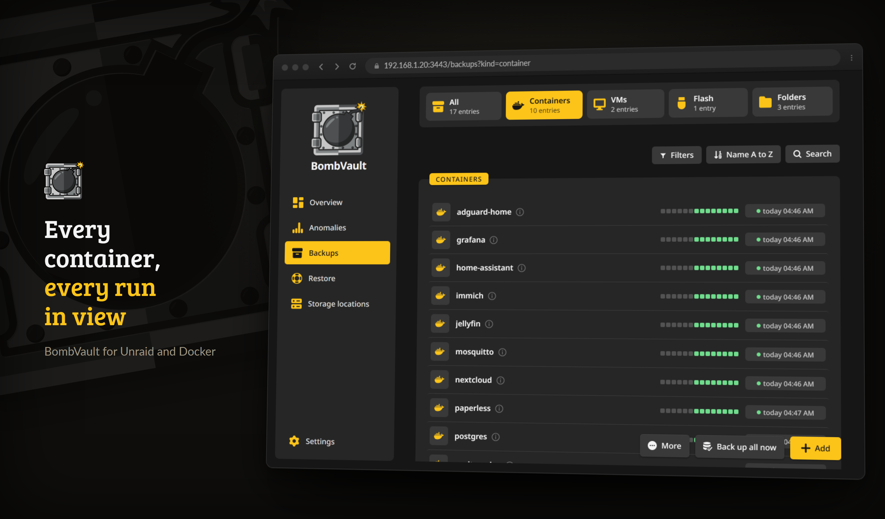
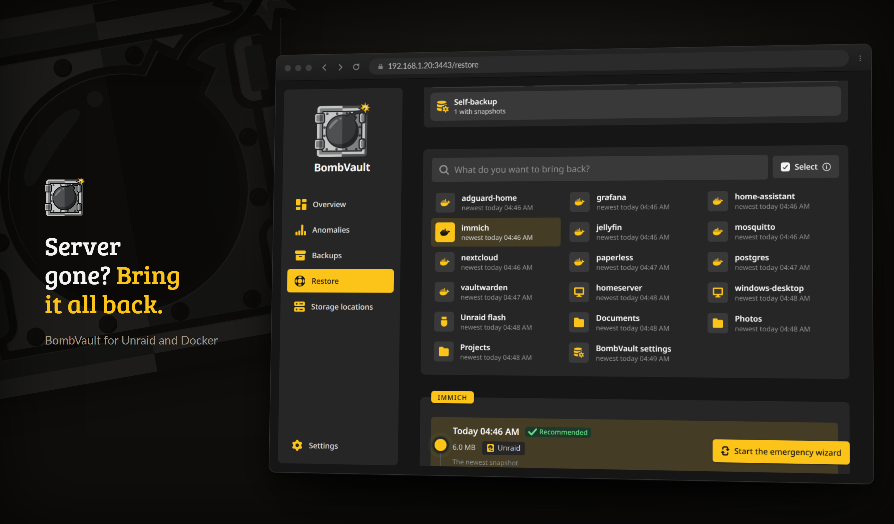

# Funksjoner

Alt BombVault sikkerhetskopierer, står i én liste, hvert element har en egen side, gjenoppretting starter på én side, og innstillingene er fliser. Det finnes ingen avansert modus å slå på; sjeldne ting har et eget kort eller et eget vindu. Denne siden grupperer hele funksjonssettet.

## Omfang av sikkerhetskopiering

*Listen Sikkerhetskopier: hvert element med de siste kjøringene som en stripe, én status og handlingene sine.*

| Område | Hva som lagres |
|---|---|
| **Kontainere** | Appdata-katalogen pluss container-definisjonen (image, miljøvariabler, porter, etiketter, volumer). Som standard hele appdata-katalogen; kortet **Sikkerhetskopierte mapper** på fanen **Innstillinger** til containeren huker av nøyaktig hvilke mapper sikkerhetskopien dekker, med en levende telling av stiene, en liste over det du utelot og en bryter **Hopp over cachemapper (CACHEDIR.TAG)**. |
| **VM-er** | VM-diskimage(r), XML-definisjon og UEFI-NVRAM (grasiøs nedstengning eller live-øyeblikksbilde, over SSH). Live-øyeblikksbilder faller automatisk tilbake på en grasiøs sikkerhetskopi hvis øyeblikksbildet ikke kan lages, så en VM-sikkerhetskopi bare feiler aldri. Med **Bare endrede blokker** slått på leses en kjørende VM med qcow2-disker gjennom libvirt-sjekkpunkter, så en sikkerhetskopi leser bare blokkene som er skrevet siden forrige, og hvert øyeblikksbilde gjenoppretter fortsatt hele disken for seg selv. Disker på ZFS-zvoler strømmes med `zfs send` over den samme SSH-forbindelsen, så en VM hvis disker er zvoler, sikkerhetskopieres som én VM. Tilstanden til en passthrough-vTPM lagres ved siden av NVRAM når domene-XML-en nevner stien. En emulert vTPM, som TrueNAS setter opp for Windows 11-gjester, publiserer ikke den stien, så hold gjenopprettingsnøkkelen til en slik gjest for hånden. Se [VM-sikkerhetskopiguiden](https://github.com/junkerderprovinz/bombvault/blob/main/docs/vm-backup-ssh-setup.md). |
| **Flash** | Hele USB-flashen (`/boot`): OS, lisens, array-konfigurasjon, delinger, nettverks- og plugin-konfigurasjon. Gjenoppretting er en `.zip`-nedlasting og overskriver aldri den levende flashen. |
| **Auto-sikkerhetskopi** | BombVaults egen `/config` (innstillingsdatabase, påloggingene til målene, libvirt-SSH-nøkkelpar), tatt øyeblikksbilde av med SQLite `VACUUM INTO` slik at en database i WAL-modus aldri fanges midt i en skriving. Den kommer tilbake gjennom Nødveiviser, som starter BombVault på nytt, så den levende databasen aldri overskrives under et åpent håndtak. |
| **Mapper** | Mappesett: en hvilken som helst mappe på serveren (en deling, dokumentene dine, et fotobibliotek), hver med valgfrie ekskluderingsmønstre. **Legg til** på siden Sikkerhetskopier lister delingene den fant og tar en hvilken som helst annen mappe. Mappesett har alt de andre områdene har: tidsplaner, oppbevaring, eksterne kopier, sjekker og gjenopprettingsøvelser. |
| **ZFS-datasett** | Et datasett sammen med hvert datasett under det, lest fra ett ZFS-øyeblikksbilde slik at alle kommer fra samme øyeblikk, og lagret med restic som en mappe: deduplisert, bla-bart, enkeltfiler kan gjenopprettes. Nye underdatasett blir med av seg selv, enkelte barn kan utelates, og et barn som ikke kan leses, hoppes over og navngis. Eventuelt stoppes containere eller en kommando kjøres bare i øyeblikket for øyeblikksbildet. Volumer er ikke med: volumet til en VM sikkerhetskopieres med VM-en, et volum uten VM sikkerhetskopieres ikke ennå. Et ZFS-element kan også holde en blokk-nøyaktig replika på en andre ZFS-server. Se [ZFS-datasett](zfs-datasets.md). |

## Sikkerhetskopier og elementsider {#backups}

- **Én liste.** Containere, VM-er, mappesett, flashen, ZFS-datasett og auto-sikkerhetskopien står i én liste under **Sikkerhetskopier**. Fliser over den velger et slag, og **Filtre**, **Sorter** og **Søk** snevrer den inn. Sorter går etter navn, status, siste sikkerhetskopi, størrelse eller tidsplan, i begge retninger, og søk finner en container etter navn, image eller IP.
- **De siste kjøringene som en stripe.** En rad viser de siste fjorten kjøringene som små firkanter og én status. Alt annet om den står i infoboblen ved siden av navnet.
- **Marker som i en filbehandler.** Ctrl+klikk, Shift+klikk og Ctrl+A velger rader, et langt trykk gjør det på en telefon, og hver rad har en høyreklikkmeny. Et utvalg kan sikkerhetskopieres, gjenopprettes fra det nyeste øyeblikksbildet, eller settes på pause og gjenopptas i tidsplanen.
- **Legg til** åpner ett vindu for det BombVault ikke kan gjette: en mappe eller et ZFS-datasett. Containere, VM-er og flashen dukker opp av seg selv. På en vert uten Unraid tilbyr vinduet **Systemkonfigurasjon**, et mappesett med `/etc` å begynne med, som du går gjennom før du lagrer.
- **Ikke sikkerhetskopier** utelater et element med vilje. Det regnes da ikke lenger som ubeskyttet, og **Ikke unnta lenger** henter det tilbake.
- **Mer** på siden Sikkerhetskopier har **Oppdag sikkerhetskopier**, som bygger opp elementer igjen fra det målene inneholder (for eksempel etter en fersk installasjon), og **Gjenopprett stack** for Compose-prosjekter.
- **En side for hvert element**, med tre faner under en topp som navngir tilstanden og rommer handlingene:
    - **Sikkerhetskopier** lister øyeblikksbildene med en strek per dag, målene som har dem og databasedumpene.
    - **Innstillinger** rommer tidsplan og mål, arkivet, de sikkerhetskopierte mappene, ekskluderingsmønstre, andre containere som skal stoppes, kommandoer før og etter, databasedumper og tidligere navn. Tidsplan og mål følger standarden til området til elementet får sitt eget valg.
    - **Integritet** viser sjekkene, størrelsen per mappe, avviksovervåkingen til elementet og de siste kjøringene.
- **Merk og sammenlign.** Et øyeblikksbilde kan bære en egen tagg, og **Sammenlign med en annen sikkerhetskopi** lister filene som kom, forsvant eller endret seg mellom to av dem. En VM sammenligner diskimagene og sier hvor mye av dem som avviker.
- **Eksport** skriver et øyeblikksbilde, hvert øyeblikksbilde av et element, eller en container eller VM slik den er akkurat nå, til eksportmappen på serveren, som tar, zip eller et eget restic-arkiv.

## Gjenoppretting

*Siden Gjenoppretting: velg et område, søk etter et element og velg en sikkerhetskopi.*

- **Én side.** **Gjenoppretting** lister områdene som fliser. Søk etter det du vil ha tilbake og velg en sikkerhetskopi fra en liste med den nyeste øverst; den anbefalte er merket, etter et avvik er det den siste før det. **Åpne element** fører til siden til elementet, og en pågående gjenoppretting vises under **Pågår nå**.
- **Ett vindu for alle slag.** Det spør i steg: hvilken **Sikkerhetskopi** (den anbefalte er forhåndsvalgt), hvilken **Kilde** (lokal er raskest), **Hva** (alt, eller filene og mappene du velger) og **Hvor til**. En scene viser målet du valgte, og **Hva som skjer** sier det i ord før du starter.
- **Ved siden av originalen er standard.** En container kommer tilbake som en andre container med navnet `<navn>-restored`, med egne porter, mens originalen fortsetter å kjøre. Diskene og NVRAM til en VM havner i en mappe `<mappe>-restored` ved siden av originalen, uten en andre VM. Et mappesett kommer tilbake som `<sti>-restored`. Kopien står under Sikkerhetskopier som utelatt til du legger den til i tidsplanen.
- **Erstatt originalen tar først en sikkerhetskopi.** Med **Ta sikkerhetskopi av dagens tilstand først**, på som standard, sikkerhetskopierer BombVault det som er der nå før det erstattes, så du kan gå tilbake. Feiler den sikkerhetskopien, starter ikke gjenopprettingen. Å erstatte ber deg skrive navnet på elementet.
- **Til en mappe** skriver bare filene, for å bla i dem. Et ZFS-datasett kan også gjenopprettes **Til et nytt dataset**, og flashen kommer tilbake som **Last ned som ZIP**.
- **Containere installeres automatisk på nytt.** Container-definisjonen spilles av på nytt mot Docker-API-et, så containeren dukker opp igjen i Unraids Docker-fane akkurat som den var.
- **GPU, grenser og lenker kommer tilbake.** En gjenopprettet container får tilbake ressursgrensene, loggdriveren, DNS-innstillingene, legacy-lenkene og GPU-en eller runtimen sin (`--gpus`, `--runtime=nvidia`). På en vert uten den GPU-driveren eller runtimen sier gjenopprettingen det og tilbyr **Gjenopprett uten GPU og runtime**, også etter å ha gjenopprettet flere containere eller en stack. En lenke til en container som mangler, eller som er stoppet mens den gjenopprettede starter, utelates, og kjøringshistorikken sier det.
- **VM-er gjenskapes automatisk.** XML-en importeres på nytt over SSH, så VM-en dukker opp igjen i VM Manager med disken og UEFI-NVRAM koblet til igjen, selv etter at VM-en ble slettet.
- **Flash-gjenoppretting er en `.zip`-nedlasting.** Den strømmer til nettleseren din som `flash-<id>.zip`, klar til å slippes i Unraids USB-oppretter. Den levende `/boot` røres aldri.
- **Én plugin om gangen.** Flash-gjenopprettingsvinduet lister pluginene i hver flash-sikkerhetskopi med versjon og størrelse, og setter én tilbake i den kjørende flashen: `.plg`-filen, mappen under `config/plugins` og pakkefilene sikkerhetskopien har. Ingenting annet på flashen endres. Unraid installerer pluginen ved neste oppstart, eller med en gang under **Plugins, Install Plugin**.
- **Planlagt flash-zip-eksport.** Etter hver flash-sikkerhetskopi kan du skrive øyeblikksbildet ut som en vanlig `.zip` til en mappe du velger (én overskrevet `flash-latest.zip` eller en rullerende historikk). Det er kortet **Flash-zip-eksport** på fanen Innstillinger til flash-elementet. Pek det mot en Syncthing- eller rclone-mappe, så forlater den oppstartbare USB-sikkerhetskopien serveren automatisk.
- **Forhåndssjekk av konflikter.** Før noe stoppes eller fjernes, verifiserer gjenopprettingen at den statiske IP-en og de publiserte vertsportene til containeren er ledige, og avbryter med en tydelig melding i stedet for å la en halvferdig gjenoppretting ligge.
- **Sjekker før gjenopprettingen.** Vinduet sjekker først at arkivet svarer, at den lagrede nøkkelen åpner det, at gjenopprettingspunktet finnes og at målet har plass til det gjenopprettingen skriver. Start forblir låst mens en sjekk feiler, og (i) i knappen sier hvilken.
- **Hva gjenopprettingen endrer.** Før du bekrefter, viser vinduet hva gjenopprettingen gjør sammenlignet med det som er der nå: nye, erstattede og uendrede filer, med listen på forespørsel, og filene på målet som ikke finnes i sikkerhetskopien og blir liggende. For containere og VM-er sammenligner det også innstillingene gjenopprettingen gjenskaper med de kjørende: image og tagg, porter, variabelnavn og volumer, eller minne, vCPU-er, disker og nettverk. restic regner dette ut som en prøvekjøring ut fra størrelse og endringstid, uten å lese filene; et svært stort tre stopper etter 30 sekunder og sier det. En stack-gjenoppretting sjekker og planlegger hvert medlem og navngir det som blokkerer.
- **Delte mapper.** En gjenoppretting på stedet navngir hver annen container, kjørende eller ikke, hvis bind-montering når inn i en mappe den skriver til, for eksempel «denne stien brukes også av nextcloud-db». Den advarer og blokkerer ikke.
- **Gjenoppretting av ZFS-datasett.** Gjenopprett ett datasett i et element på plassen sin (etter et ZFS-sikkerhetsøyeblikksbilde som blir til du sletter det), til en mappe, til et nytt datasett, eller bare filene du velger, eller hvert datasett i en sikkerhetskopi til en mappe. Et datasett rulles aldri tilbake eller erstattes.
- **Gjenoppretting beholder kjøretilstanden.** En container eller VM som kjørte da den ble sikkerhetskopiert, kommer tilbake kjørende; en som var stoppet, forblir stoppet. Huk av **La stå stoppet etterpå** for å gjenskape uten å starte.
- **Gjenopprett en hel stack.** Containere fra samme Docker Compose-prosjekt med minst to sikkerhetskopierte medlemmer danner en stack. **Gjenopprett stack** under **Mer** på siden Sikkerhetskopier bygger opp hvert medlem fra den siste sikkerhetskopien og starter dem eventuelt i `depends_on`-rekkefølge.
- **Levende fremdrift, avbryt og opptattmeldinger.** En lang gjenoppretting viser en levende prosentlinje og kan avbrytes med en bekreftelse tilpasset typen. En avbrutt gjenoppretting registreres som *avbrutt*, ikke som mislykket. Vinduet kan lukkes; fremdriften vises også under Gjenoppretting.
- **Nødveiviser.** For en server som er borte eller satt opp på nytt, med gjenopprettingssettet, gjennom gruppen eller med den inntastede nøkkelen. Se [Ekstern lagring og gjenoppretting](offsite-recovery.md#emergency).
- **Fra en gammel sikkerhetskopimappe.** En skrivebeskyttet økt åpner arkivet til en annen BombVault med gjenopprettingssettet til den instansen eller dens inntastede `APP_KEY`, så du kan hente en container fra server A til server B uten å røre dine egne innstillinger. Se [Ekstern lagring og gjenoppretting](offsite-recovery.md#restore-from-another-bombvault-repo).
- **ZFS-egenskaper kommer tilbake.** Hver ZFS-sikkerhetskopi beholder de lokalt satte egenskapene til hvert datasett, som komprimering, postgrense, kvote og skille mellom store og små bokstaver. En gjenoppretting til et nytt datasett oppretter det med dem, og en gjenoppretting til et eksisterende datasett viser dem og setter dem bare når du ber om det. Se [ZFS-datasett](zfs-datasets.md#new-dataset).
- **Import fra pluginen Appdata.Backup.** Pek BombVault under **Andre kilder** på siden Gjenoppretting mot sikkerhetskopimappen til pluginen. Hvert containerarkiv blir et gjenopprettingspunkt for containeren sin, datert da pluginen laget det. Arkiver som er importert før, hoppes over, og selve arkivene leses bare. Containeren trenger først én sikkerhetskopi i BombVault, slik at gjenopprettingen har definisjonen. Oppbevaringen lar importerte gjenopprettingspunkter være, så slett ett selv når du ikke trenger det lenger.

## Lagring og tidsplan

- Inkrementelle, deduplisterte sikkerhetskopier via restic, så selv store VM-disker ikke blåser opp repoet.
- **Mål.** Lokale mapper og eksterne steder står i én liste på siden **Mål**, som du åpner fra innstillingsflisen eller fester til sidefeltet. Hvert mål har en egen side med tilkobling, legitimasjon, beskyttelse mot sletting, kopieringsinnstillinger, oppbevaring og regler per område, og et kar som viser hvor fullt det er og når det blir fullt ved veksten de siste ukene. Se [Mål](offsite-recovery.md#destinations).
- **Slag av lagring:** en lokal sti, SMB-delinger og WebDAV-servere (Nextcloud, ownCloud, SharePoint) gjennom rclone uten vertsmontering, NFS (monter eksporten på Unraid og bruk den som lokal mappe), native restic-backender uten rclone (`s3:...`, `rest:http://host:8000/repo`, `sftp:user@host:/repo`), eller en hvilken som helst rclone-remote via `rclone:<remote>:<bucket>/path`. All legitimasjon lagres kryptert.
- **SSH-mål trenger ingenting installert på den andre siden.** `sftp:` krever bare en SSH-server, så en bar Raspberry Pi (ingen Docker, ingen restic) fungerer som eksternt mål. Vertsnøkler festes automatisk ved første kontakt.
- **3-2-1 som bilde.** Kortet **Mål per område** tegner hvilket område som sikkerhetskopieres hvor. Hver linje fra et område til et mål er en bryter, og **Graf / Brytere** gir det samme som vanlige knapper. Elementer som sikkerhetskopieres et annet sted enn området sitt, står under **Eget valg**, hvert med **Følg standarden**.
- **Ekstern kopi (lokal + ekstern).** Behold den raske lokale sikkerhetskopien og legg til ett eller flere eksterne mål, kopiert med `restic copy` på best-effort-basis (et eksternt hikk feiler aldri den lokale sikkerhetskopien). En kopi overfører bare datapakkene målet ikke har ennå. Kortet **Kopier** til hvert mål setter **Når det kopieres** (**Etter hver sikkerhetskopi** eller en egen plan) og båndbredden, og et område kan kopiere etter en egen plan under **Innstillinger, Tidsplan**.
- **Flere mål per område.** Hvert område kan kopiere til flere eksterne mål samtidig. **Regler per område** hos et mål gir ett område sin egen oppbevaring, komprimering eller sitt eget arkiv der, mens pålogging, legitimasjon, båndbredde og timing kommer fra målet.
- **Flytt historikken til et område.** **Flytt** på et mål tar kopien av et område, med hele historikken, til et annet mål. Det gamle stedet beholder alt; BombVault sletter ingenting der.
- **Navngitte arkiver.** Kortet **Depoter** under **Innstillinger, Mål** skriver ned sikkerhetskopiplasseringene dine én gang, en lokal sti eller en restic-remote med et eget legitimasjonssett, som kan velges som plassering for et element. En rad viser hvor mange elementer som peker på det, og et arkiv som et element eller en standard bruker, kan ikke flyttes eller slettes, fordi BombVault aldri flytter en sikkerhetskopi som allerede er skrevet.
- **Flere sett med legitimasjon.** Den delte skylegitimasjonen gjelder overalt som standard, men hvert mål kan bruke et navngitt sett i stedet (**Ekstra legitimasjonssett** under **Innstillinger, Mål**, eller **Legitimasjon** på siden til målet), så en Hetzner S3-bøtte og en lokal Garage-server kan kjøre side om side, hver med sin egen nøkkel.
- **Plassering per element.** Kortet **Tidsplan og mål** på fanen Innstillinger til et element har en rad med knapper, **Lokal** og én per eksternt mål, og de tente får sikkerhetskopiene. En deling som allerede ligger på en NAS, trenger ikke også gå til B2. Plasseringen er fast fra første sikkerhetskopi, kopiene kan endres når som helst, og kortet sier hvor mange steder som har elementet og om 3-2-1 er oppfylt. Se [Plassering per element](offsite-recovery.md#placement).
- **Manuell sikkerhetskopirekkefølge.** Kortet **Rekkefølge** under **Innstillinger, Tidsplan** setter den nøyaktige rekkefølgen containere og VM-er sikkerhetskopieres i. Planlagte kjøringer og full sikkerhetskopi følger den; det du lar stå urangert, beholder mest-forfalt-først-rekkefølgen, og en enkelt sikkerhetskopi er uendret.
- **Oppbevaring som tidslinje.** Hvert mål beholder sikkerhetskopier etter **Hvor lenge det beholdes**: **Kort**, **Balansert**, **Lang** eller **Egne verdier** for de siste sikkerhetskopiene, dager, uker, måneder og år, beskåret automatisk. Tidslinjen viser hvilke sikkerhetskopier en regel beholder. **Spør før det beholdes mindre** spør før en kortere regel sletter eldre sikkerhetskopier hvis eneste kopi ligger der. Et område kan beholde egne verdier hos ett mål under **Regler per område**.
- **Komprimering per arkiv:** Av, Automatisk (standarden til restic) eller Maksimal, satt på hvert mål og, for ett område, under reglene dets der. Sikkerhetskopier, eksterne kopier og beskjæring skriver med den, og gjenopprettingssettet navngir den, så vanlig restic kan fortsette å skrive på samme måte.
- **Tidsplaner leses som setninger**, for eksempel *Ukentlig søndag kl. 04:00*, og redigeres ut fra den setningen. **Innstillinger, Tidsplan** rommer dem alle: båndet **Uke** med hver planlagte kjøring fra mandag til søndag, **Full sikkerhetskopi** med én kommando før og én etter, **Tidsplaner per område**, **Off-site-kopier per område** og de **Planlagte elementene**. **Hver N. dag** fungerer også for gjenopprettingsøvelsen, tamper-testen og ukesammendraget.
- **Et område med egen plan forlater den fulle sikkerhetskopien.** Knappen **Unntak** under **Tidsplaner per område** gir et område en egen plan, og det området kjører da til sin egen tid og ikke igjen i den fulle sikkerhetskopien, så ingenting sikkerhetskopieres to ganger. **Sikkerhetskopier alt nå** tar fortsatt hvert område som er slått på. Med **Egne tidsplaner per element** slått på kan en enkelt container, VM, et mappesett eller ZFS-datasett få en egen plan på siden sin, og forlater da også den fulle sikkerhetskopien.
- **Oppdater containere etter en vellykket sikkerhetskopi.** Én bryter under **Innstillinger, Tidsplan, Oppdateringer etter sikkerhetskopien**, av som standard, henter et nytt image først etter at sikkerhetskopien før er ferdig. En enkelt container kan settes annerledes på sin egen side.
- **Vent til appen er rolig.** En container kan la den planlagte sikkerhetskopien vente mens appen er opptatt, i høyst de timene du setter, og starte så snart appen er rolig. En medieserver regnes som rolig når den ikke strømmer, enhver annen container når CPU og trafikk holder seg under grensene i kortet **Ro før sikkerhetskopi** under **Innstillinger, Tidsplan** i noen minutter (på vertsnettverket teller bare CPU). Den ventende sikkerhetskopien vises i aktivitetsloggen og på containeren med årsak og frist. Den holder ingen lås, så de andre containerne går videre. Manuelle sikkerhetskopier venter aldri. Medlemmene av en compose-stack som skal kjøre i samme kjøring, venter sammen, og en ventetid fortsetter med fristen sin etter en omstart. Å slå av containerne dropper hver ventende sikkerhetskopi, og å slå av tidsplanen deres dropper dem kjøringene holdt tilbake. Å senke timene forkorter en ventetid som allerede har begynt.
- **Eksterne båndbreddegrenser.** Begrens resticts opplastings-/nedlastingshastighet slik at kopier ikke metter WAN-et ditt, i kortet **Ekstern båndbredde** under **Innstillinger, Mål** og per mål i kortet **Kopier**.
- **Strømming først.** Mens en medieserver som Plex, Jellyfin eller Emby strømmer, laster eksterne kopier opp med en lavere grense og går tilbake til den vanlige noen minutter etter at strømmen slutter. BombVault leser medieserverne sin utgående trafikk fra Docker. REST, S3, B2, Azure, Google Cloud, Swift og rclone over HTTP bremser midt i en kopi; SFTP og lokale eller monterte mapper tar den lavere grensen ved neste kopieringssteg. En medieserver på vertsnettverket kan ikke måles. Det er kortet **Strømming** på siden Mål.
- **Kald og arkiv-lagringsklasse (S3).** For et S3-mål kan du velge lagringsklasse, begrenset til gjenopprettingslesbare nivåer (Standard, Standard-IA, One Zone-IA, Intelligent-Tiering, Glacier Instant Retrieval), så arkivpriser aldri i stillhet ødelegger en gjenoppretting. Dyparkivnivåene som først trenger en asynkron opptining (Glacier Flexible, Deep Archive) er utelatt, fordi restic ikke kan lese fra dem. Bare native S3-backender; rclone-remoter setter klassen sin i rclone-konfigurasjonen.
- **Sikkerhetskopimapper kan kopieres bort fra maskinen.** Etter hver sikkerhetskopi løsner BombVault det lokale repotreet til mapper `0755` / filer `0644` (repoer er kryptert, så ingenting eksponeres), slik at en ikke-root synkroniseringsbruker over SMB ikke låses ute. Gjenopprettingsdefinisjoner bor inne i hvert repo, så en kopiert repomappe er helt selvstendig.

## Innsikt, verifisering og overvåking

- **Oversikten.** Den begynner med et statushode og fire kort: **Krever oppmerksomhet**, **Beskyttelsesstatus**, **Mål** med en prognose for når hvert blir fullt, og **Historikk** med kjøringene og loggen. Ringen i hodet viser hvor mye som er beskyttet og blir en fremdriftsring med stasjonene sine mens en sikkerhetskopi kjører. Flere kort venter under **Tilpass**: **Avvik**, **Ikke sikkerhetskopiert**, **Kalender**, **Lagring**, **Oversikt**, **Statistikk** og **Host-integrasjon**. Hvert kort kan flyttes, endres i størrelse og skjules, og oppsettet lagres i nettleseren.
- **Én telling overalt.** Hvert kort teller elementene i områdene som er slått på, på samme måte.
- **Pause fra elementet.** **Sett tidsplanen på pause** tar et element ut av tidsplanen og ut av den fulle sikkerhetskopien, og **Gjenoppta tidsplanen** henter det tilbake. Det setter den samme bryteren som **I tidsplanen** på fanen Innstillinger til elementet, så de to alltid stemmer overens. Et element på pause bærer et grått merke **Tidsplan på pause**, og **Sikkerhetskopier nå** virker fortsatt.
- **Beskyttelsesstatus.** Hvert område har fire sjekker: en fersk sikkerhetskopi på denne serveren, en kopi eksternt, beskyttelse mot sletting der og en testgjenoppretting derfra. En forfalt sikkerhetskopi blir rød i stedet for å gjemme seg i en logg, og et klikk på et område viser detaljene.
- **Kalender.** De siste 90 dagene, én firkant per dag med utfallet av sikkerhetskopien den dagen. Et klikk på en dag viser linjene dens i loggen under Historikk.
- **Kjøretid overalt.** Hver kjøring lyder `start, slutt (varighet)`, og hvert element har sin egen liste **Siste kjøringer** på fanen Integritet.
- **Arkivstørrelse og dedup-trend.** Kortet **Lagring** viser hvor mye hvert område tar og hvor godt dataene dedupliseres.
- **Gjenopprettingsverifiserings-øvelser.** BombVault beviser jevnlig at sikkerhetskopiene dine kan gjenopprettes (`restic check --read-data-subset`, begrenset), satt opp under **Innstillinger, Verifisering, Automatiske kontroller**. Kortet **Kontroller sikkerhetskopier** på samme flis viser resultatet per område og rommer **Lås opp** og **Beskjær** under **Mer**.
- **Gjenopprettingssjekk etter den første sikkerhetskopien.** Når den første sikkerhetskopien til et element er ferdig, gjenoppretter BombVault et utvalg av den (opptil 100 filer og 256 MiB) til en midlertidig mappe under gjenopprettingsmappen, lar restic lese hver fil tilbake mot hashene sine og sammenligner størrelsene med sikkerhetskopien. En fil som er for stor for utvalget, for eksempel en VM-disk, får i stedet de første 64 MiB lest tilbake. Fanen Integritet til elementet viser resultatet, en feil går ut som varsel, og **Sjekk gjenoppretting** kjører den samme sjekken på den nyeste sikkerhetskopien når du vil. Senere sikkerhetskopier gjentar den ikke.
- **Starttest.** Å sjekke bytene viser ikke at appen kommer tilbake. **Starttest** på fanen Integritet til en container gjenoppretter den nyeste sikkerhetskopien i en isolert kopi og starter den: et navn som begynner med `bombvault-test-`, et eget internt Docker-nettverk uten publiserte porter og uten vei til LAN-et, 1 CPU og 2 GiB minne, og dataene i en midlertidig mappe under gjenopprettingsmappen. Testen består når helsesjekken til containeren melder sunn, eller, uten en, når den første eksponerte porten svarer innenfra det nettverket, eller, uten noen av delene, når den fortsetter å kjøre. Den opprinnelige containeren stoppes eller endres aldri, og kopien, nettverket og dataene fjernes etterpå, også etter en omstart av BombVault midt i en test. Containere på vertsnettverket, privilegerte, de med enheter og de som trenger en annen container, vises som ikke testbare. Slå på **Starttest** under **Innstillinger, Verifisering, Automatiske kontroller** for å teste én container per kjøring, den som ble testet for lengst siden først. Kopien bærer ingen av etikettene til originalen og kjører uten capabilities, sikkerhetsvalg, sysctls og cgroup-parent originalen legger til. En container som trenger dem, feiler testen sin, og resultatet navngir hva kopien kjørte uten.
- **Selvhelbredende operasjoner.** En påviselig foreldreløs restic-lås (etterlatt av en omstart midt i en operasjon) tvangsfjernes og forsøkes på nytt én gang, automatisk. Oppbevaringen er identitetsstabil (beskåret per element, immun mot sti- eller vertsendringer), og en feil i oppbevaringen sender et varsel.
- **Advarsler mappeskanningen ikke kan se.** Ekskluderingsassistenten svarer på et størrelsesspørsmål. Noen av de dyreste sikkerhetskopifeilene er ikke størrelsesspørsmål, så den bærer også appspesifikke forbehold om hvordan en applikasjon lagrer dataene sine. Det den finnes for: Immich lagrer albumene, ansiktene og datoene til hvert bilde i en PostgreSQL-database som kjører i en *egen* container, så en sikkerhetskopi på filnivå av Immich-containeren gjenoppretter bildene uten noe av det, og gjenopprettingen ser ut som om den virket. Advarselen vises enten en ekskludering tilbys eller ikke, også på en container uten noe valgt å skanne, fordi forbeholdet er sant uansett.
- **Ikke sikkerhetskopiert (dekning).** Et oversiktskort som navngir alt på serveren som ingen planlagt sikkerhetskopi dekker, med årsaken for hvert: aldri lagt til i BombVault, til stede men ikke i tidsplanen, sin egen tidsplan satt til av, eller ingen tidsplan slått på noe sted. Beskyttelsesstatusen svarer på et annet spørsmål, nemlig om sikkerhetskopiene som *er* planlagt, kjørte i tide, og den kan ikke se containeren ingen noensinne har satt opp. Containere leses fra den levende Docker-listen i stedet for fra BombVaults egne rader, fordi et element uten rad er nettopp det som må navngis. Et område du slo av og et element du merket **Ikke sikkerhetskopier**, holdes utenfor tellingen, siden det var ditt valg.
- **Forhåndsvisning av oppbevaringen.** Kortet **Forhåndsvisning** under **Innstillinger, Mål** viser hva neste kjøring er i ferd med å slette, før det skjer: per arkiv og per element, med gjenopprettingspunktene navngitt. Det tar ingen arkivlås og endrer ingenting, så det svarer selv mens en sikkerhetskopi kjører. Avslått oppbevaring sier det i stedet for å vise en tom liste, et append-only-arkiv merkes som det (oppbevaring kjører aldri der), og et arkiv som ikke kunne nås, navngis i stedet for å mangle i stillhet.
- **Avvik.** Hver sikkerhetskopi av en container, VM, et mappesett, en databasedump, flashen og auto-sikkerhetskopien sammenlignes med den egne historikken til elementet. Kontrollene ser på de nye dataene en kjøring lagret, mot de største vanlige mengdene i nylige sikkerhetskopier og mot den vanlige raten per time; på en sikkerhetskopi som lagret mesteparten av dataene på nytt, noe som omfatter filer som ble omdøpt og skrevet om; på kildestørrelsen og antall filer restic melder for hvert element og hver databasedump; på resticts egen sikkerhetskopitid; på feilrekker og tilfeldige feil; på gjenopprettingssjekker som sluttet å bestå; og på ledig plass i lokale, SFTP- og rclone-arkiver, projisert fra veksten i arkivet. Et element lærer av de første 10 sikkerhetskopiene sine, mens en nesten tom kilde, en omskriving av mesteparten av dataene og feil sjekkes fra starten. Følsomhet (Streng, Balansert, Romslig) og den laveste alvorlighetsgraden som sender et varsel, settes globalt i kortet **Avvik** under **Innstillinger, Verifisering** og kan endres per element på fanen Integritet. Advarsler lukkes av seg selv så snart årsaken er borte; kritiske funn om tapte data og en disk som fylles, blir til du kvitterer for dem, og et kvittert funn reises ikke igjen før årsaken har vært borte én gang. **Merk som forventet** gjør et nytt nivå normalt etter 10 sikkerhetskopier men slår aldri av nesten-tom-sjekken, og et endret utvalg starter historikken til elementet på nytt av seg selv. Så lenge en kilde er nesten tom, har krympet kraftig eller har fått mesteparten av dataene lagret på nytt, beholder oppbevaringen de gamle sikkerhetskopiene til elementet til du kvitterer for funnet eller merker det som forventet, og funnet lenker til den siste gode sikkerhetskopien. Et varsel går ut én gang per episode, og feil og gjenopprettingssjekker som allerede varsler, rapporteres ikke to ganger. Hva det ikke gjør: S3-, B2- og REST-arkiver har ikke noe tall for ledig plass, på Unraids brukerdeling er den ledige plassen hele arrayets, og sikkerhetskopier laget før restic 0.17 har ingen størrelseshistorikk. ZFS-elementer sjekkes også, datasett for datasett: hvert datasett i et tre har sin egen historikk, ett som ble tømt eller ikke lenger kunne leses, regnes som tapte data, og bare de gamle sikkerhetskopiene til det datasettet beholdes. Hvordan et ZFS-element overvåkes datasett for datasett, er beskrevet under [ZFS-datasett](zfs-datasets.md#anomalies), og en assistent kan lese de åpne funnene gjennom [MCP-serveren](mcp.md#tools). Et funn om størrelsen eller antall filer i en kilde dateres til den første sikkerhetskopien det viste seg i, og **Sammenlign med kopien før** lister mappene der filer forsvant, kom inn eller endret seg, med en merknad når nesten alt ligger i en søkeindeks, en cache eller miniatyrbilder appen bygger opp igjen selv.
- **Siden Avvik.** Fliser for **Kritisk**, **Advarsler** og **Merknader** velger en alvorlighetsgrad, med åpne og lukkede funn over listen. Et funn tilbyr rettingen først, og detaljene viser verdien som en kurve over det vanlige området. Når ingenting er åpent, viser en ring per element hvor langt oppdagelsen har lært hva som er normalt.
- **Anbefalte ekskluderinger per app.** For kjente images (Plex, Jellyfin, Emby, Sonarr, Radarr, Lidarr, Readarr, Prowlarr, Immich, Nextcloud, PhotoPrism og Tautulli, fra linuxserver, hotio, binhex eller den offisielle utgiveren) tilbyr ekskluderingsassistenten i kortet **Ekskluderingsmønstre** mappene appen fyller igjen av seg selv: cacher, logger, forhåndsvisningsbilder og plakater. Hver oppføring sier hva den rommer, hver kan slås av, og ingenting ekskluderes før du trykker **Unnta valgte**.
- **Feilrapport.** **Feilrapport** i kortet **Hjelp** under **Innstillinger, Info** laster ned en redigert ZIP for et GitHub-issue: host-integrasjonssjekken, konfigurasjonen din med hver hemmelighet fjernet, de siste kjøringene, hva som er planlagt neste gang og den siste loggen. Den bærer også hvordan den siste dumpen av hver database gikk, ZFS-elementene med monteringene containeren ser, de åpne avvikene og hvor mange MCP-nøkler som finnes (aldri navnene deres). Passord, tokens, rclone-konfigurasjonen, varselopplysninger og ethvert passord innebygd i en arkivplassering fjernes alle, og pakken sier det i sitt eget manifest, fordi en støttefil aldri må forveksles med en konfigurasjonssikkerhetskopi. Den krever et påloggingspassord av samme grunn som gjenopprettingssettet. Loggen den bærer, er utdataene til denne containeren siden den sist startet; for et krasj som startet containeren på nytt, er `docker logs` fortsatt stedet å se.
- **Gjenopprettingssett.** **Last ned gjenopprettingssett** under **Innstillinger, Gjenoppretting** gir deg nøkkelen, det utledede restic-passordet og de nøyaktige arkivplasseringene og kommandoene, så du kan gjenopprette uten en kjørende BombVault. Det krever et påloggingspassord. Se [Ekstern lagring og gjenoppretting](offsite-recovery.md#recovery-kit).
- **Eksporter og importer innstillingene dine.** Kortet **Eksporter / importer innstillinger** under **Innstillinger, System** skriver hele konfigurasjonen din (innstillinger per område, mål, tidsplaner, oppbevaring, varsler) til en portabel JSON-fil, så å flytte til en ny boks eller klone et oppsett ikke betyr å taste inn alt på nytt for hånd. Du velger om de eksterne og varselopplysningene tas med; med dem er filen like sensitiv som gjenopprettingssettet ditt. Import viser en forhåndsvisning og ber om bekreftelse, og den rører aldri sikkerhetskopidataene eller -historikken din.
- **Varsler.** Webhook (Discord / Slack / Gotify / ntfy), Matrix, Healthchecks.io, e-post (SMTP), en selvhostet [Apprise API](https://github.com/caronc/apprise-api)-server og Unraids eget varslingssystem. Policy per sikkerhetskopi: aldri / ved feil / alltid. En planlagt kjøring av mange elementer kan sende ett sammendrag *N av M elementer vellykket*. Healthchecks får hele livssyklusen (`/start`, deretter suksess eller `/fail`) så snart en URL er satt.
- **Ukesammendrag.** Én melding i uken gjennom de samme kanalene: antall kjøringer, hvor mye nye sikkerhetskopidata som kom, om ekstern lagring er à jour og de viktigste feilene. Av som standard, med egen rytme under **Innstillinger, Varsler**, så en rolig uke også rapporteres som det.
- **Prometheus `/metrics`.** Valgfritt (av som standard, valgfritt bearer-token) i kortet **Tjenester** under **Innstillinger, Integrasjoner**, for Grafana eller Uptime Kuma. Viser sikkerhetskopistatus, størrelser og tidsstempler, uten hemmeligheter eller stier i etikettene.
- **HTTP-API, Home Assistant og mDNS.** Skript og dashbord får et API under `/api/v1` med navngitte tokens, skrivebeskyttet eller med lov til å starte sikkerhetskopier. Home Assistant finner BombVault gjennom MQTT-discovery, som en enhet med sensorer og, hvis du tillater det, en sikkerhetskopiknapp per område. Og BombVault kunngjør seg selv på nettverket som `bombvault.local`. Se [API og integrasjoner](api.md).
- **Ledig plass og uker til fullt.** Lokale arkiver, SFTP-arkiver og SMB- eller WebDAV-mål som melder det, viser ledig plass og hvor mange uker som er igjen ved dagens vekst. S3-, B2- og REST-arkiver sier «Størrelse ukjent», siden de backendene ikke melder det.
- **Størrelse per mappe.** På fanen Integritet til en container, VM eller et mappesett viser **Størrelse per mappe** hvilke mapper og filer som tar plassen i den nyeste sikkerhetskopien og hvor mye av hver den siste sikkerhetskopien tok inn nytt eller endret, ett nivå av gangen. BombVault leser det fra indeksen til arkivet uten å lese filene, og holder det à jour etter hver sikkerhetskopi når du først har åpnet det.
- **Hvorfor en sikkerhetskopi var treg.** Mens en sikkerhetskopi kjører, følger BombVault med på hvor opptatt CPU, diskene og nettverket er. Tar en sikkerhetskopi mye lengre tid enn vanlig og én ting tydelig var på grensen, sier kjøringen det, for eksempel «Måldisken disk1 var 98 % opptatt» eller «BombVault brukte 100 % av CPU-grensen til containeren sin». Ellers sier den ingenting.
- **Endret siden forrige sikkerhetskopi.** En container som er gjenskapt med et annet image, andre porter, variabler eller volumer siden siste sikkerhetskopi, får et merke ved siden av navnet. Dens (i) lister hva som endret seg, variabler bare med navn. Det er bare en merknad og forsvinner med neste sikkerhetskopi.

## Beskyttelse mot løsepengevirus

- **Beskyttelse mot sletting (append-only).** Slå den på for et eksternt mål slik at løsepengevirus eller en kompromittert host ikke kan slette eller skrive om sikkerhetskopiene dine. Den andre siden (en `restic/rest-server` i `--append-only`-modus) håndhever det; BombVault bare verifiserer det og viser aldri grønt på en konfigurasjonspåstand alene. En mappe på denne serveren kan ikke avslå sletting, så lokale mål tilbyr ikke bryteren.
- **Tamper-test.** BombVault beviser jevnlig append-only-garantien ved faktisk å forsøke en sletting mot det eksterne repoet (rettet mot et objekt som ikke finnes): avvist betyr beskyttet, godtatt betyr ikke beskyttet. Et uavklart resultat snur aldri den lagrede dommen. **Test beskyttelsen mot sletting nå** på siden til et mål kjører den på forespørsel.
- **Veiledet oppsett.** **Legg til mål** leder deg fra leverandøren via innloggingen, en tilkoblingstest og mappen til et ærlig ord om beskyttelse mot sletting og områdene som sikkerhetskopieres dit.
- **DR-øvelser (eksternt).** Testgjenopprettingen legger et ekte mål fra det eksterne repoet i en avskjermet sandkasse, verifiserer det fil for fil og byte for byte, og rydder opp. Se [Ekstern lagring og gjenoppretting](offsite-recovery.md).
- **Beskyttelsesstatus.** Oversiktskortet sjekker hvert område for en fersk sikkerhetskopi, en ekstern kopi, beskyttelse mot sletting der og en testgjenoppretting derfra. Det blir bare grønt på verifiserte fakta.
- **Vekstbudsjett-varsel.** For et append-only-mål (der gamle øyeblikksbilder aldri beskjæres herfra) setter du et størrelsesbudsjett og får beskjed før det løper løpsk.
- **Sletting krever et passord.** Å slette sikkerhetskopiene på et mål krever et påloggingspassord og en pålogging på selve instansen, så verken en paret telefon eller et åpent grensesnitt kan gjøre det.
- **Paring med frase.** Instanser blir med i én gruppe med tolv ord: lag frasen på én og skriv den inn på neste. Medlemmer på samme nettverk snakker direkte, de andre gjennom et relay (prosjektrelayet, ditt eget eller ingen), og hvert kall mellom dem er ende-til-ende-kryptert. Gruppen bærer beskyttelsesstatusen på siden Instanser, rolleforespørsler, lagringstilbud og det en mottaker eller henter trenger når rollen er tillatt, aldri sikkerhetskopidata og aldri APP_KEY. Se [Ekstern lagring og gjenoppretting](offsite-recovery.md#pairing).
- **Instanser og roller.** Slå på **Instanser** under **Innstillinger, Instanser, Flere servere** for en side med et kort for hver instans i gruppen din, denne medregnet: adressen, om den er tilkoblet og beskyttelsen til hvert område med den siste sikkerhetskopien. Rollene står på kortet som fliser: **Mottaker**, **Henter**, **ZFS-server** og **Nøkkelvokter**. En rolle starter først når noen på den andre instansen trykker **Tillat**, og gruppen vises som et nett av hvem som gjør hva for hvem. **Sjekk nå** ber et medlem verifisere arkivet til ett område. Ingenting på siden kan starte en sikkerhetskopi, gjenoppretting eller sletting på en annen boks. Se [Instanser og roller](offsite-recovery.md#roles).
- **Lagringstilbud.** Et medlem kan tilby sin egen eksterne lagring til et annet medlem over gruppen. Den andre administratoren ser tilbudet i **Detaljer** for medlemmet på siden Instanser og godtar eller avslår det; å godta oppretter et vanlig legitimasjonssett og mål. Bare tilkoblingsdetaljer reiser slik, aldri sikkerhetskopidata.
- **Mottatte arkiver (mottakssiden).** På boksen som mottar append-only eksterne kopier fra en annen BombVault slår du på **Mottaker** under **Innstillinger, Instanser** og legger til det mottatte arkivet i **Detaljer** for det sendende medlemmet, skrivebeskyttet (åpnet med den sendende instansens restic-passord, som kommer over paringsgruppen). Du ser inventaret av øyeblikksbilder gruppert etter kilde, når hver kilde sist kom, og kan kjøre en uavhengig `restic check` på mottaksmaskinvaren. Den varsler deg når en kilde slutter å sende innenfor et vindu du setter (en dødmannsbryter) eller når en integritetssjekk feiler. Strengt skrivebeskyttet, så den skriver aldri til det mottatte arkivet, og av som standard. Se [Ekstern lagring og gjenoppretting](offsite-recovery.md#receiver).
- **Hent fra en annen instans (hentesiden).** Speilbildet av en ekstern kopi: i stedet for at denne boksen skyver øyeblikksbildene sine ut, henter den noen andres inn. Slå på **Henting** under **Innstillinger, Instanser**, og legg deretter til en kilde i **Detaljer** for det andre medlemmet: arkivplasseringen, hvilket slag sikkerhetskopi det rommer og hvor ofte det skal hentes. Restic-passordet kommer over gruppen, aldri APP_KEY. Den andre siden konfigurerer ikke noe mer og trenger ikke kjøre. Kildearkivet leses bare: det åpnes for å sjekke passordet, listes og navngis som kilden til kopien, og initialiseres, låses opp, beskjæres eller skrives til aldri. Hver side beholder sin egen legitimasjon, og en `rclone:`-kilde avvises fordi rclone ville nådd den med remotene til denne instansen. Se [Ekstern lagring og gjenoppretting](offsite-recovery.md#receiver).
- **Nøkkelvokter.** En annen instans i gruppen din kan oppbevare en forseglet kopi av gjenopprettingssettet til denne serveren, som bare frigivelseskoden din på 20 tegn åpner og som den bare leverer ut etter at noen der trykker **Tillat**. Se [Nøkkelvokter](offsite-recovery.md#key-keeper).

## Rene eksporter

- **Container- og VM-eksport.** **Eksporter container** og **Eksporter VM** under **Mer** på siden til et element skriver en blabar, verktøyfri kopi ved siden av repoet: sikkerhetskopimappene til containeren slik de er akkurat nå pluss Unraid-malen, eller diskimagene til VM-en pluss definisjonen, gjenopprettbar med `virsh define` pluss disken, uten BombVault eller restic. **Eksport** på et øyeblikksbilde skriver en lagret sikkerhetskopi på samme måte, som tar, zip eller et eget restic-arkiv. restic forblir motoren; dette er en ekstra bekvemmelighetskopi.
- **Krypter de rene eksportene (age).** Eksportene ligger utenfor restic, så de er klartekst som standard. Slå på **Krypter eksporter med age** under **Innstillinger, System** og legg til én eller flere mottakere (en age-offentlig nøkkel eller en SSH-offentlig nøkkel). Hver eksport (også flash-ZIP-en) forsegles da for disse mottakerne, og du dekrypterer den senere utenfor boksen med den tilhørende private nøkkelen. Som sikkerhetsregel feiler en eksport med en tydelig feil hvis kryptering er på og ingen gyldig mottaker er satt, i stedet for noen gang å skrive klartekst.
- **Gjenopprettingssettet forsegles også.** Med den samme innstillingen på lastes settet ned som `bombvault-recovery-kit.md.age`. Det er ASCII-armert i stedet for binært, så det forblir ren lesbar tekst: du kan fortsatt lime det inn i en passordbehandler eller skrive det ut, noe settet er til for. Den samme sikkerhetsregelen gjelder, så kryptering på uten brukbar mottaker nekter nedlastingen i stedet for å falle tilbake til å dele ut hovednøkkelen i klartekst. Én ting å få riktig når du slår dette på: du trenger din private age-nøkkel for å åpne settet, så oppbevar den nøkkelen et sted som ikke avhenger av selve settet.

## AI-assistenter (MCP) {#mcp}

BombVault har en innebygd MCP-server, slik at en assistent som Claude Code eller Claude Desktop kan lese sikkerhetskopistatus, dekning, kjøringshistorikk, gjenopprettingspunkter og pågående aktivitet. Med en nøkkel som tillater det kan assistenten også starte en sikkerhetskopi av ett element, ett område eller alt, og avbryte sikkerhetskopiene den startet. Gjenoppretting, sletting, beskjæring og innstillinger blir i nettgrensesnittet. Hver klient får en egen nøkkel under **Innstillinger, Integrasjoner, MCP-server**; en nøkkel vises én gang, lagres bare som fingeravtrykk og kan når som helst gis nytt navn, erstattes eller trekkes tilbake. Starter er begrenset per time og per element, og en oppbevaringsvakt hindrer at assistentsikkerhetskopier skyver dine egne gjenopprettingspunkter ut av en «behold siste N»-policy. Hver kjøring en assistent starter, er merket «via MCP» med navnet på nøkkelen. Se [MCP-server](mcp.md). Databasedumper og [ZFS-datasett](zfs-datasets.md) hører med blant elementene og gjenopprettingspunktene den leser, og den kan liste avvikene BombVault la merke til.

## Apper og følgesvenner {#apps}

- **Android-app.** Hver server i gruppen din på telefonen, med aktivitetsloggen for alle på én skjerm. Den parer med gruppen din med QR-kode og åpner hver server allerede pålogget, med en økt som bare når det appen viser. Se [Android-app](android.md).
- **Mottaksserver.** Boksen som mottar eksterne kopier, kjører en append-only rest-server, satt opp første gang den tillater en **Mottaker**-forespørsel, og tilbyr den til de andre instansene i gruppen din, hver med en egen pålogging. Se [Mottaksserver](offsite-recovery.md#receiving-server).
- **Innstillinger, Apper.** En side som begynner med Android-appen, APK-en for utgaven serveren kjører og en QR-kode for den, etterfulgt av et kort for hver følgesvenn. Kortet til ParleyPort tilbyr Unraid-malen, kopierer Docker-kommandoen som starter den og fører til repoet og til relay-innstillingene under Paring. Kortet til BombVault Widget tilbyr malen og repoet, og installerer eller fjerner pluginen over vertens SSH-forbindelse.
- **BombVault Widget.** En flis på Unraid Dashboard med aktivitetsloggen til BombVault og neste planlagte kjøring. Uten vertens SSH-forbindelse gir kortet deg `.plg`-adressen å installere under **Plugins, Install Plugin**, og pluginen kan fjernes der som alle andre.
- **Innebyggbar aktivitetslogg.** Generer et skrivebeskyttet token i kortet **Dashbord-widget** under **Innstillinger, Integrasjoner**, så får du en adresse for et hvilket som helst dashbord som viser en iframe, som Homepage, Organizr eller Heimdall: en liten side med bare den levende aktivitetsloggen. Tokenet gir den loggen og ingenting annet, og **Deaktiver** trekker det tilbake med en gang. Den innebygde siden finnes bare på engelsk.

## Annet

- **Stopp en sikkerhetskopi som kjører.** Mens en kjøring er aktiv, står **Avbryt sikkerhetskopi** ved siden av fremdriften. Kjøringen registreres som *avbrutt*, ikke som mislykket. Å stoppe er trygt, fordi restic skriver øyeblikksbildet sitt sist, så en avbrutt kjøring etterlater ureferert data og ikke noe øyeblikksbilde.
- **Sikkerhetskopier mange samtidig.** Marker elementer i listen Sikkerhetskopier og sikkerhetskopier utvalget. Batchen kjører på serversiden, så den fortsetter selv om du lukker fanen eller mister forbindelsen. BombVault sikkerhetskopierer (og stopper dermed) aldri sin egen container.
- **Øyeblikksbilder på siden til elementet** med en liste over gjenopprettingspunkter, sletting per øyeblikksbilde, en egen tagg og en sammenligning mellom to øyeblikksbilder.
- **Arkivvedlikehold per område** i kortet **Kontroller sikkerhetskopier** under **Innstillinger, Verifisering**: en sjekk (`restic check`), og under **Mer** **Lås opp** (fjern en fastlåst lås) og **Beskjær** (bruker oppbevaringspolicyen på forespørsel når en er satt, ellers en vanlig plassgjenvinning).
- **Fremdrift for sjekker, gjenopprettingssjekker og beskjæring.** Mens en av dem kjører, viser aktivitetsloggen og kortet **Kontroller sikkerhetskopier** hvor langt restic har talt, for eksempel *12 av 47 pakker*, med gjenstående tid i det steget når det er nok å anslå den av. restic teller pakker, øyeblikksbilder og indeksfiler her, ikke byte, så det er det linjen viser; før den første tellingen kjører den uten tall.
- **Automatiske databasedumper.** Gjenkjente PostgreSQL-, MySQL- og MariaDB-containere (de offisielle imagene, PostGIS, TimescaleDB, pgvector, pgautoupgrade, databaseimagene til Immich, linuxserver-, yobasystems- og jc21-MariaDB og Oracles mysql-server) dumpes før hver sikkerhetskopi, fra den kjørende serveren. Containere som bare ligner på en database, får det samme alternativet i kortet **Database** på fanen Innstillinger, avslått til du velger det. Dumpen strømmer rett inn i arkivet som et eget gjenopprettingspunkt, ved siden av filsikkerhetskopien, og skrives aldri til en disk. Legitimasjon kommer fra containerens egne variabler, inkludert `*_FILE`-hemmeligheter, og forlater den aldri. Kortet viser om datamappen til databasen lagres mens den er stoppet, kopieres mens den kjører, eller ikke lagres i det hele tatt. En mislykket dump feiler ikke sikkerhetskopien: den vises som en mislykket kjøring med årsak og et hint om hvordan den rettes, og sender et varsel. Dumper lastes aldri tilbake automatisk. Last ned en (vanlig eller komprimert), lagre den i en mappe, importer den med ett klikk i en nystartet database, eller hent den med restic-CLI. Slå det av per container med etiketten `bombvault.dbdump=false`, eller for alle containere med **Automatiske databasedumper** under **Innstillinger, Generelt**. Avviksoppdagelsen overvåker også størrelsen på hver dump, og en assistent kan liste dumpene til en container gjennom [MCP-serveren](mcp.md#tools).
- **Kommandoer før og etter, per container.** Skallkommandoer som kjører inne i containeren (for eksempel å tømme en cache); en kommando som feiler før sikkerhetskopien, avbryter den. Gjenkjente databaser dumpes automatisk, så de trenger ingen kommando.
- **Stopp andre containere under sikkerhetskopien, med en helsestyrt omstart.** Navngi avhengige containere (for eksempel en database) i **Stopp andre containere** for å stoppe mens denne sikkerhetskopieres. Etterpå henter BombVault dem tilbake i Compose-`depends_on`-rekkefølge og venter som standard til hver melder sunn (eller kjørende, hvis den ikke har noen helsesjekk) før den starter containerne som er avhengige av den, slik at en avhengighet som Pi-hole, en database eller en VPN-gateway faktisk er oppe før tjenestene som trenger den, i stedet for at de kommer tilbake til en *connection refused*. Ventingen begrenses av en tidsavbrudd per container (120 sekunder som standard), slik at en treg eller aldri-sunn container aldri kan henge kjøringen; både ventingen og tidsavbruddet ligger under **Omstart etter sikkerhetskopiering** i kortet **Rekkefølge** under **Innstillinger, Tidsplan** (slå av ventingen for en omstart alt på én gang). Den samme ordnede, helsestyrte omstarten omslutter også image-oppdateringen etter sikkerhetskopien, så på en dag da en oppdatering lander, holdes de avhengige nede gjennom gjenskapingen og hentes først tilbake, helsestyrt, når den er ferdig.
- **Ekskluderingsmønstre per container.** List undermapper som skal hoppes over inne i et sikkerhetskopiert volum, én per linje. Skriv stiene slik du ser dem inne i containeren; en levende forhåndsvisning viser hva hver linje løses til og advarer når en linje ikke ville ekskludere noe.
- **Oppdater etter en vellykket sikkerhetskopi (av som standard).** Slå på **Oppdater containere etter en vellykket sikkerhetskopi** under **Innstillinger, Tidsplan, Oppdateringer etter sikkerhetskopien**, eller sett en enkelt container annerledes på siden sin, så henter BombVault det nyeste imaget og gjenskaper containeren, men bare når det faktisk finnes et nyere image, slik at et ferskt gjenopprettingspunkt alltid finnes først. Valgfrie tillegg: et varsel per oppdatert container og **Fjern det gamle imaget etter en oppdatering** (et basisimage som deles av andre containere, slettes aldri). Etter oppdateringen ber BombVault også Unraid sjekke oppdateringsstatusen til akkurat den containeren på nytt, så det foreldede *oppdatering tilgjengelig*-banneret i Docker-fanen forsvinner av seg selv i stedet for å bli hengende (Unraid-oppdateringer går rett gjennom Docker-API-et, så den hurtiglagrede statusen, og på noen versjoner en hurtiglagret digest, ville ellers fortsatt å vise banneret). Det er best-effort, påvirker aldri sikkerhetskopien, er på som standard og byttes med **Oppdater Unraids oppdateringsstatus etter oppdatering av en container** i det samme kortet.
- **Gjenopprett til en alternativ mappe** for kloning eller inspeksjon.
- **Hva er nytt etter en oppdatering.** Utgivelsesnotater dukker opp én gang per ny versjon, servert fra notater innebygd i binærfilen, så dialogen fungerer frakoblet. Grønne prikker markerer hver endring på siden sin, og kortet **Nytt** under **Innstillinger, Info** lister dem alle med **Gå dit**.
- **Info.** **Innstillinger, Info** rommer **Versjon** (BombVault, GlimStone, restic og rclone, med **Se etter oppdateringer**), **Hjelp** med **Håndbok** og **Feilrapport**, **Nytt** og **Om BombVault**.
- **HTTPS rett ut av boksen** (selvsignert, eller ta med ditt eget sertifikat bak en omvendt proxy).
- **Docker-helsesjekk.** Containeren melder sunn/usunn fra sin egen `/api/health`, så et auto-heal-verktøy kan starte den på nytt hvis motoren noen gang skulle sette seg fast.
- **42 språk** med en flaggvelger under **Innstillinger, Utseende**.
- **Innstillinger lagrer seg selv.** Vri en bryter eller forlat et felt, så skrives endringen med en gang, med et kort glimt på kontrollen og en risting hvis serveren avviser den. Noen få steder beholder en Lagre-knapp fordi halvferdig lagring ville vært utrygt, som rclone-konfigurasjonsboksen, redigereren for legitimasjonssett og påloggingspassordet.
- **Rolige varsler.** Under **Innstillinger, Utseende** kan du dempe de rutinemessige bekreftelsene, så bare feil fortsatt avbryter deg. Dette rører ikke varslingskanalene.
- **Få det til å se ut slik du vil.** **Innstillinger, Utseende** setter **Tema** (Mørkt, Lyst eller System), fargene (ett aksentfarge, eller *Regnbuemodus* med en palett på åtte), hjørnene (runde, myke eller firkantede), animasjonen (av, diskret, vill eller storm) og rekkefølgen på innstillingsflisene. BombVault beholder utseendet på serveren, og en nettleser som kommer for første gang, overtar det. Når systemet ditt ber om mindre bevegelse, vinner det alltid.
