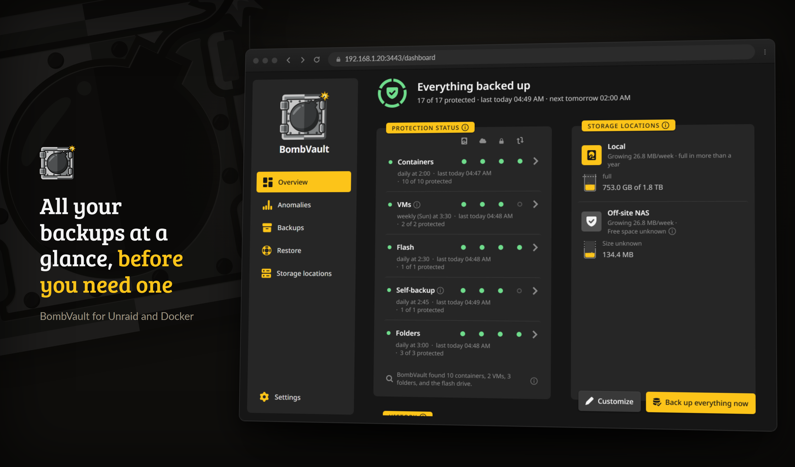
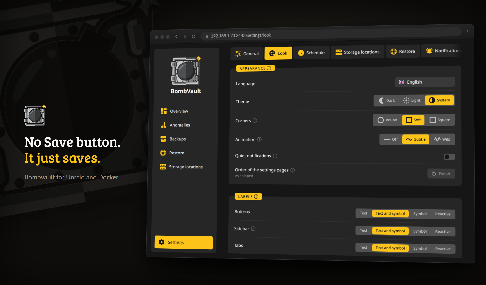

# Aan de slag

Deze pagina leidt je van een verse Unraid-machine naar je eerste back-up.

## Vereisten

| Vereiste | Opmerkingen |
|---|---|
| **Unraid 6.12+** | Eerdere versies zijn niet getest. Unraid is het hoofddoel, maar BombVault draait ook op een gewone Docker-host en op TrueNAS Scale (zie [Generieke Docker-host](#generic-docker-host)). |
| **Locatie restic-repo** | Een lokaal pad (aanbevolen: je array of cache), SMB, NFS, of elke rclone-backend. |
| **Docker-socket** | Automatisch gemount door de template (`/var/run/docker.sock`). |
| **Unraid-flash** (`/boot`) | In zijn geheel automatisch gemount door de template (`/boot` naar `/host/boot`). Maakt flash-back-up mogelijk en laat een herstelde container weer verschijnen als een normale, bewerkbare Unraid-app. |
| **KVM-VM's** (opt-in) | VM-back-up praat met libvirt via SSH, geen libvirt-mount. Stel het in onder **Instellingen, Integraties, Host-SSH** (zie [Configuratie](configuration.md)). |
| **ZFS-datasets** (opt-in) | Dezelfde SSH-verbinding als voor VM-back-ups, `zfs` op de host, en Host Data gemapt als `/mnt` met toegangsmodus Read/Write - Slave, de standaard van de template. Zie [ZFS-datasets](zfs-datasets.md). |
| **Android-app** (optioneel) | Android 10 of nieuwer, gekoppeld met servers op versie 9.7.0 of nieuwer. Zie [Android-app](android.md). |

## Installeren op Unraid

De makkelijkste weg is **Community Applications**.

1. Open het tabblad **Apps** in Unraid.
2. Zoek naar **BombVault**.
3. Klik op **Install**, stel de vereiste variabelen (hieronder) in en pas toe.

!!! tip "Template handmatig installeren"
    Als je de template liever met de hand toevoegt:

    1. Ga naar **Docker, Add Container, Template repositories** en voeg toe:
       ```
       https://github.com/junkerderprovinz/unraid-apps
       ```
    2. Zoek naar **BombVault** in Templates.
    3. Stel de vereiste variabelen in en klik op **Apply**.

## Generieke Docker-host {#generic-docker-host}

Geen Unraid? BombVault draait ook als gewone container op elke Docker-host (dat is ook waar de containerondersteuning op TrueNAS Scale op rust, vooruitlopend op een eigen vermelding in de app-catalogus daar).

1. Haal het kant-en-klaar te bewerken bestand [`deploy/docker-compose.generic.yml`](https://github.com/junkerderprovinz/bombvault/blob/main/deploy/docker-compose.generic.yml) uit de repository.
2. Stel `APP_KEY` in (zie hieronder) en richt het Host Data-volume op je echte datawortel. De opmerkingen in het bestand lopen beide door.
3. `docker compose up -d`, open daarna `https://<host-ip>:3443/`.

Wat er anders is dan bij Unraid:

- **Geen onderdeel Flash.** Er is geen opstart-USB om vast te leggen of terug te zetten, dus het onderdeel Flash heeft hier niets te doen. In plaats daarvan biedt **Toevoegen** op de pagina Back-ups **Systeemconfiguratie** aan als mapsuggestie: een eerste mappenset met `/etc` die je nakijkt en aanpast voor je opslaat.
- **Geen Unraid-eigen meldingen.** BombVaults eigen meldingskanalen (webhook, waarschuwingen bij mislukte off-site en dergelijke) werken gewoon; alleen de Unraid-specifieke melding aan diens eigen meldingssysteem blijft achterwege, omdat zo'n systeem hier niet bestaat.
- **Back-up van virtuele machines is optioneel en vraagt een aparte libvirtd-host die via SSH bereikbaar is.** Zie het uitgecommentarieerde blok in het compose-bestand. Een generieke Docker-host heeft zelf geen VM-beheer.
- **Geen dashboardwidget.** De BombVault Widget is een Unraid-plugin, dus die stap vervalt ook.
- **De data van een container vinden.** Zonder de `appdata`-conventie van Unraid wordt de datamap van een container gevonden via de segmenten in `DATA_ROOT_SEGMENTS`, benoemde Docker-volumes, de werkmap van een Compose-project en het label `bombvault.data` (zie [Herkenning van de back-upbronnen](configuration.md#backup-source-detection)). Benoemde volumes en de `/etc`-voorinstelling bereiken alleen paden binnen de Host Data-mount, dus richt Host Data op een gemeenschappelijke bovenliggende map die ook de dataroot van Docker omvat.
- **`PLATFORM`.** Zet het op `generic` of `truenas`. Zonder waarde herkent BombVault Unraid aan diens eigen markering op de flash-mount en behandelt het al het andere als generiek, en worden de stappen die alleen voor Unraid zijn overgeslagen in plaats van geprobeerd en mislukt.

**TrueNAS Scale** volgt dezelfde compose-route; een catalogusvermelding is in de repository voorbereid, maar nog niet ingediend. VM-back-up heeft daar `LIBVIRT_URI` nodig, omdat de libvirtd van TrueNAS op een eigen socket luistert (`/run/truenas_libvirt/libvirt-sock`) die de drie `LIBVIRT_*`-variabelen niet kunnen uitdrukken (zie [Configuratie](configuration.md)). Hoe ver dit bewezen is: de zvol-back-up is uitgevoerd op een echte TrueNAS Scale-machine, op een zvol die aan een draaiende VM hing, en `zfs snapshot`, `zfs send`, restic en `zfs receive` brachten hem byte voor byte heen en terug. Een volledig herstel dat door BombVault zelf wordt aangestuurd, is nog niet op TrueNAS-hardware uitgevoerd, en die zvol was thin-provisioned, dus de doorvoer bij vele gigabytes is niet getest. Test daar een herstel voordat je erop vertrouwt.

## De ene vereiste instelling

De enige variabele die je moet instellen is `APP_KEY`, een 32-byte hex-geheim (64 hex-tekens) dat wordt gebruikt om het wachtwoord van de restic-repository af te leiden.

Genereer er een op een willekeurige machine:

```bash
openssl rand -hex 32
```

Plak het resultaat in het `APP_KEY`-veld van de template (Unraid), of in de omgevingsvariabele `APP_KEY` in `docker-compose.yml` (generieke Docker-host).

!!! danger "Raak je APP_KEY niet kwijt"
    Als je `APP_KEY` kwijtraakt, zijn je versleutelde back-ups onherstelbaar. Bewaar het ergens veilig en gescheiden van de server. Stel zodra BombVault draait een inlogwachtwoord in en download de **herstelkit** onder **Instellingen, Herstel** (zie [Off-site en herstel](offsite-recovery.md#recovery-kit)). Die bevat de sleutel, elke bestemming en de restic-commando's.

De template mount ook de Docker-socket, de flash (`/boot`) en de root **Host Data** (`/mnt`) voor je. Back-up*bronnen* en *bestemmingen* leven allebei onder Host Data. Voor de volledige variabelenreferentie en de off-site setup, zie [Configuratie](configuration.md).

## Eerste keer draaien



*Het overzicht na een eerste back-up: wat aandacht nodig heeft, de bescherming van elk onderdeel, de bestemmingen en de geschiedenis.*

1. Open de web-UI op `https://<jouw-unraid-ip>:3443` (out-of-the-box een zelfondertekend certificaat). Een nieuwe installatie opent op **Welkom bij BombVault**, dat laat zien wat BombVault op de server heeft gevonden.
2. Kies **Aan de slag**. Het overzicht toont dan de kaart **Eerste stappen** met drie stappen:
    1. **Kies onderdelen**: schakel in wat BombVault back-upt (Containers, VM's, Flash, Mappen, ZFS-datasets, Zelf-back-up). **Kiezen** opent de lijst met items van een onderdeel, waar **Schema pauzeren** er een buiten laat. De onderdelen die je hier inschakelt, draaien elke nacht; dat wijzig je onder **Instellingen, Planning**.
    2. **Bestemming toevoegen**: waar de back-ups heen gaan. Een lokale map is genoeg om te beginnen. Het veiligst is een tweede bestemming buiten de deur, zoals een Storage Box of Backblaze B2. Lokale repositories gaan standaard naar `/mnt/user/bombvault/{container,vms,flash,config,files,zfs}` en worden bij de eerste back-up aangemaakt.
    3. **Eerste back-up**: daarna draait het elke nacht vanzelf.
3. Open **Back-ups** om elk item in één lijst te zien. **Nu alles back-uppen** start een run over alle ingeschakelde onderdelen, en **Nu back-up maken** op de pagina van een item back-upt alleen dat ene.

Eerder BombVault gebruikt? **Herstellen vanaf een back-up** op de welkomstpagina opent de pagina Herstel, waar de **Noodassistent** de instellingen, containers, VM's en mappen van een verloren server terugbrengt. Zie [Off-site en herstel](offsite-recovery.md#emergency).

!!! tip "Optioneel: kies een back-upvolgorde"
    Als sommige containers altijd vóór andere geback-upt moeten worden (bijvoorbeeld een database vóór de app die hem gebruikt), open dan de kaart **Volgorde** onder **Instellingen, Planning** en sleep ze in de gewenste volgorde. Geplande runs en de volledige back-up volgen die volgorde daarna; alles wat je ongeordend laat, wordt geback-upt met het meest-achterstallige eerst.

!!! note "Host-integratiecontrole"
    De kaart **Host-integratie** in het overzicht test elke mount en CLI (Docker-socket, libvirt, restic, qemu-img, rclone) en meldt eventuele ontbrekende onderdelen, zodat je kunt bevestigen dat de container correct is aangesloten voordat je erop vertrouwt. Hij wacht onder **Aanpassen** tot je hem toevoegt.

## Je weg vinden {#navigation}



*Instellingen als tegels, met de kaarten van de gekozen tegel ernaast. Elke wijziging wordt weggeschreven zodra je haar maakt.*

De zijbalk heeft vijf ingangen: **Overzicht**, **Anomalieën** (zolang anomaliedetectie aanstaat), **Back-ups**, **Herstel** en, onder **Afmelden**, **Instellingen**. De hoofdactie van een pagina zweeft rechtsonder, en **Meer** bevat de zeldzame. Op een telefoon bevat de balk Overzicht, Back-ups, Herstel en Instellingen, en **Meer** heeft de rest.

Pagina's en instellingen gebruiken de volle breedte van het venster. Een venster houdt zijn knoppen in zijn voet, met de knop die vooruit gaat rechts. Op een telefoon houdt een voet met meer dan drie knoppen de uitweg en de hoofdactie en zet de rest onder **Meer**.

- **Back-ups** toont elke container, VM, mappenset, de flash, elke ZFS-dataset en de zelf-back-up als items. Tegels boven de lijst kiezen een soort, en **Filters**, **Sorteren** en **Zoeken** versmallen de lijst. Elk item heeft een eigen pagina met drie tabbladen: **Back-ups**, **Instellingen** en **Verificatie**. Een terugknop links van het icoon van het item leidt naar de lijst.
- **Herstel** is één pagina voor alles: kies een onderdeel, zoek een item en kies een back-up. De Noodassistent en de andere bronnen beginnen hier ook.
- **Instellingen** zijn veertien tegels: Algemeen, Uiterlijk, Planning, Bestemmingen, Herstel, Meldingen, Verificatie, Beveiliging, Instanties, Koppeling, Integraties, Apps, Systeem en Info. Druk op `/` of Ctrl+K om ze allemaal te doorzoeken, ook op de namen die pagina's in eerdere versies hadden. Sleep de tegels onder **Uiterlijk** in je eigen volgorde.
- **Bestemmingen** en **Instanties** zijn instellingentegels met eigen pagina's. **Ook in de zijbalk tonen** op hun tegel zet ze vast in de zijbalk.

Niets heeft een Opslaan-knop en niets klapt uit: zeldzame dingen hebben een eigen kaart of een venster, en uitleg staat in de (i)-bellen. Na een update markeren groene stippen wat er veranderd is. Een klik verbergt een stip, en **Nieuw** in de kaart Versie onder **Instellingen, Info** toont elke wijziging met **Ga erheen**.

## Bouwen vanaf de broncode {#build-from-source}

BombVault is één statische Go-binary die een JSON-API en een ingebouwde React-interface serveert. Bouw eerst de interface en start daarna de binary:

```bash
npm --prefix web ci
npm --prefix web run build     # schrijft web/dist, dat de binary insluit
export APP_KEY=$(openssl rand -hex 32)
go test ./...                  # unit- en integratietests, met een echte restic-rondgang heen en terug
golangci-lint run ./...
go run ./cmd/bombvault         # serveert https://localhost:3443 met een zelfondertekend certificaat
```

De interface-build is ook nodig voor `go run`. De repository bevat onder `web/dist` alleen een lege markering, dus zonder `npm --prefix web run build` sluit de binary niets in en antwoordt hij met `500 SPA index not found`, en dat is zo bedoeld. Docker, libvirt en Unraid kunnen niet in CI worden getest, dus controleer mounts, restic en de SSH-verbinding voor VM's op een echte host met de kaart **Host-integratie** van het overzicht (of `GET /api/spike`) voordat je een pull request opent.

## Volgende stappen

- Blader door de volledige **[Functies](features.md)**.
- Zet elke server van je groep op je telefoon met de **[Android-app](android.md)**.
- Voeg een of meer bestemmingen buiten de deur toe (elk onderdeel kan tegelijk naar meerdere kopiëren) en bewaar je herstelkit, zoals beschreven onder **[Off-site en herstel](offsite-recovery.md)**.
- Een setup klonen of naar een nieuwe machine verhuizen? Neem je hele configuratie mee met de kaart **Instellingen exporteren / importeren**. Zie [Configuratie](configuration.md#portable-settings-export-and-import).
- Loop je vast? Zie **[Probleemoplossing](troubleshooting.md)**.
