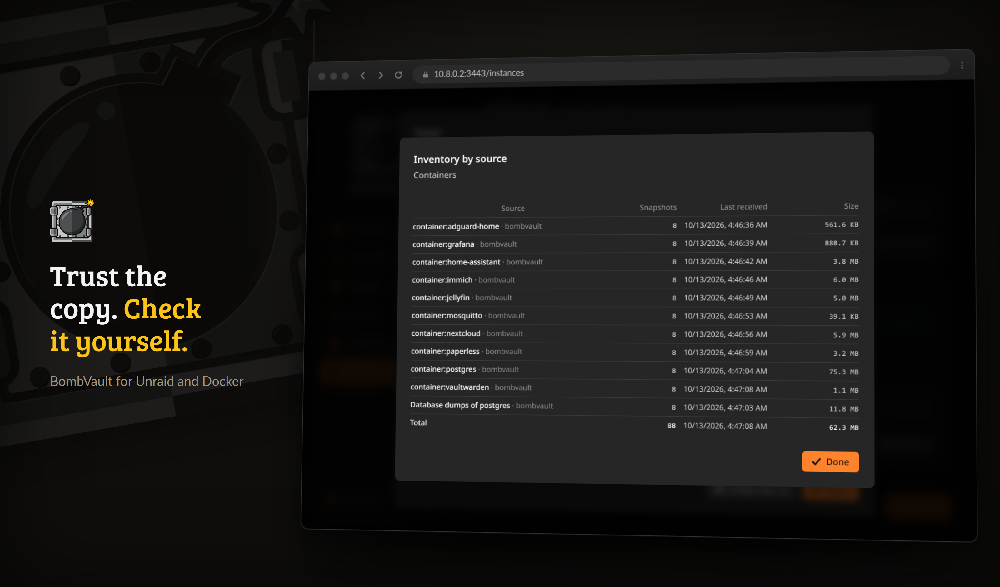

# Site dışı ve kurtarma

!!! note "Site dışı kopyalar bir yeniden kurulumdan sonra bekler"
    Acil durum sihirbazı ya da **Yedekleri keşfet** ögeleri eski ayarlar olmadan yeniden kurduğunda, o bölümlerin site dışı kopyaları varsayılanları onaylanana kadar duraklar. Bkz. [Bir yeniden kurulumdan sonra](#after-a-rebuild).

Yerel yedekler seni kaybolmuş bir konteynerden ya da kötü bir güncellemeden korur. Site dışı kopyalar ve denenmiş bir kurtarma kiti seni tüm makineden, fidye yazılımından ya da bir yangından korur. Bu sayfa hedefleri ve site dışı kopyaları, bir kopyayı kurcalamaya karşı korumayı, geri yükleyebildiğini kanıtlamayı, birkaç sunucuyu eşleştirmeyi ve BombVault'un kendisi gittiğinde her şeyi geri almayı kapsar.

## Site dışı kopyalar {#off-site-copies}

Hızlı yerel yedeği koru ve bina dışında bir ya da daha fazla hedef ekle. BombVault yeni yedekleri oraya en iyi çabayla `restic copy` ile kopyalar; böylece site dışında yaşanan bir aksaklık yerel yedeği asla başarısız kılmaz. Bu biçimde yerel depo birincil kalır ve site dışı depo bir kopyadır, ama bir bölümün birincil deposunun yerel olması hiç gerekmez; kopyalamak yerine doğrudan S3'e, bir rest-server'a ve benzerlerine yedeklemek için aşağıdaki [Uzak birincil depolar](#remote-primary-repositories) bölümüne bak.

- **Bölüm başına birkaç hedef.** Her bölüm (konteynerler, VM'ler, flash, Öz yedek, klasörler ve ZFS veri kümeleri) aynı anda birkaç site dışı hedefe kopyalayabilir; böylece örneğin bir arkadaşının makinesindeki bir rest-server'ı ve bir S3 kovasını paralel tutabilirsin. Hedefler sayfasındaki **Bölüme göre hedefler** kartı, bir bölümden bir hedefe giden her satırı açar ya da kapatır.
- **Kopyaların çalıştığı zaman.** Bir hedefin **Kopyala** kartı **Ne zaman kopyalanır** ayarını belirler: **Her yedekten sonra**, ya da yedekleri toplayıp sabit saatlerde kopyalayan kendi planı. **Ayarlar, Zamanlama, Bölüm başına site dışı kopyalar** altında **İstisna**, bir bölüme kendi kopya planını verir. **Ayarlar, Hedefler** altında bir bölümün **Site dışı kopya** kartındaki **Şimdi çoğalt** istek üzerine bir kopya başlatır.
- **Saklama**, hedef başına **Ne kadar saklanır** altında ayarlanır; böylece site dışı kopyaları bir arşiv olarak daha uzun tutabilirsin. Bir bölümün site dışı alanındaki kopya, **Ayarlar, Hedefler** altındaki **Site dışı saklama** kartını izler; site dışı yedekleri asla otomatik kırpmamak için hepsini sıfır bırak.
- **Bant genişliği sınırları** (**Ayarlar, Hedefler** altında **Site dışı bant genişliği** ya da bir hedefin **Kopyala** kartı), kopyalar WAN'ını doldurmasın diye restic yükleme/indirme hızını sınırlar.
- Bir kopya çalışırken genel bakışın durum başlığı **Site dışı kopyalama sürüyor** der. Bu bir yüzde çubuğu değil, etkin bir göstergedir, çünkü `restic copy` makine tarafından okunabilir bir ilerleme sunmaz.

!!! note "Herhangi bir yerden geri yükle"
    Her öge, yedeklerini **Yedekler** sekmesinde, bir yedeğin bulunduğu tüm yerler boyunca tek bir zaman çizelgesi olarak listeler. B2'ye kopyalanmış bir yedek, onu tutan her yerle işaretlenmiş olarak bir kez görünür. Bir geri yükleme ulaşabildiği ilk yeri alır, ögenin yazıldığı depoyla başlar ve yedek başına başka bir yer seçebilirsin. Site dışı hedefler yalnızca **Kontrol et**'e tıkladığında okunur, çünkü bulut depolamayı listelemek biraz sürer. Bir yerde silmek önce diğerlerini denetler ve son kopya olup olmadığını söyler.

## Hedefler {#destinations}

Bir hedef, yedeklerin gittiği yerdir: yerel bir klasör, bir paylaşım, kendi sunucun ya da bir bulut hizmeti. Bir kez kurulur ve sonra her bölüme hizmet eder. **Hedefler**'i ayar kutucuğundan aç ya da orada **Kenar çubuğunda da göster**'i açıp sabitle.

**Hedef ekle** dört adımlı bir pencere açar:

1. **Sağlayıcı.** Her hizmet logosuyla, pencerenin sağ üstünde bir aramayla, gruplar halinde listelenir: S3 kovalı depolama hizmetleri (Backblaze B2, Wasabi, Cloudflare R2, Hetzner Object Storage, Amazon S3 ve diğerleri), kendi S3 sunucun (Garage, SeaweedFS, RustFS, Silo, Ceph, JuiceFS, Versity S3 Gateway), kendi sunucun ve paylaşımların (rest-server, Hetzner Storage Box, SFTP, SMB, WebDAV, bağlanmış bir yol), bulut depolama (OneDrive, Google Drive, Dropbox, pCloud, Nextcloud ve rclone'un desteklediği diğerleri) ve grubunun alıcı sunucuları. Her biri yedekler için ne kadar uygun olduğunu söyler: bulut sürücüleri çok sayıda istek altında yavaşlar, bu yüzden ilk yedekleme ve budama orada daha uzun sürer.
2. **Oturum aç.** Alanlar hizmete bağlıdır: S3 için bir erişim anahtarı, WebDAV ve SMB için bir kullanıcı ve parola, iki adımlı oturumun normal olanı engellediği yerde bir uygulama parolası, SFTP ve Storage Box için BombVault'un genel SSH anahtarı ya da tarayıcı üzerinden oturum açan hizmetler için bir belirteç. Bunlar için pencere, tarayıcılı bir bilgisayarda çalıştırılacak bir `rclone authorize` komutu gösterir; yazdırdığı belirteç alana girilir. **Test et**, hiçbir şey kaydedilmeden önce oturum açmayı denetler. Pencere sonra hedefteki klasörleri listeler; birini oluşturmak için **Yeni klasör** ve hizmetin bildirdiği yerde boş alan vardır. Boş bir klasör en güvenlisidir; BombVault içine bölüm başına bir klasör koyar.
3. **Koruma.** Pencere hizmetin neler yapabileceğini açıkça söyler. Append-only kipindeki bir rest-server silmeyi reddeder ve kurcalama testi bunu denetler. Bir S3 kovası, BombVault'un henüz denetleyemediği sürümleme ve nesne kilidiyle eski sürümleri tutabilir. Bir bulut sürücüsü silmeyi hiç reddedemez: sunucuya giren o kopyaya da girer. **Silmeye karşı koruma (append-only)**'ı yalnızca karşı taraf silmeyi gerçekten reddediyorsa aç; BombVault o zaman orada asla budamaz. **Acil durum için**, kurtarma kitinin bu hedef için neleri tuttuğunu söyler.
4. **Hangi bölümler için.** Burada yedekleyecek bölümleri seç. İlk kopya tüm geçmişi de getirir. Kendi hedeflerini seçmiş ögeler yenisini kendiliğinden almaz ve pencere onları adlandırır.

S3 hizmetleri restic'in kendi S3 arka ucu üzerinden çalışır; bir depolama sınıfının ve nesne kilidinin uygulanabilmesi bundandır. Diğer her hizmet BombVault'un birlikte gönderdiği rclone üzerinden çalışır ve remote'u **Ayarlar, Hedefler** altındaki **Site dışı (rclone)** kartında görünür. Bir ayar dışa aktarması hedefleri taşır; kimlik bilgileri dahil edilirse oturum bilgilerini de taşır.

Bu sunucudaki klasör her yerde **Yerel** olarak adlandırılır: hedef sayfalarında, akışta, bir ögede ve Geri yüklemede. Bu sunucuda birden çok klasör varsa her biri kendi adıyla anılır. Bir bölümün site dışı alanının oluşturduğu hedef, yerinin adını alır; bu, adresinin son klasörüdür, yoksa sunucusudur, ve aynı adı taşıyan başka bir hedef varsa bir numara alır. Sayfasında ona verdiğin ad kalır. Aynı adı taşıyan iki hedef yan yana durduğunda her biri sunucusunu ya da klasörünü de taşır.

Her hedefin kendi sayfası vardır:

- Adıyla **Bağlantı**, **Kullanılabilir** anahtarı (kapalı, BombVault'un artık buraya yazmadığı anlamına gelir ve burada yedekleyen ögeler başka bir yere düşmek yerine açık bir iletiyle başarısız olur), klasör, sıkıştırma, depolama sınıfı ve **Bina dışında**. **Bağlantıyı değiştir** yeni bir adresi veya oturum bilgisini sınar ve kaydeder.
- **Kimlik bilgileri**: paylaşılan küme ya da kendi kümesi.
- **Silmeye karşı koruma**; **Silmeye karşı korumayı şimdi sına** ile ve bu kopyayı kimin budadığıyla.
- **Kopyala**: ne zaman kopyalanacağı ve yükleme ile indirme sınırları.
- **Ne kadar saklanır**: **Kısa**, **Dengeli**, **Uzun** ya da **Özel değerler**; kuralın hangi yedekleri tuttuğunun bir zaman çizelgesiyle. **Daha az saklamadan önce sor**, daha kısa bir kural, tek kopyası burada olan yedekleri silmeden önce sorar.
- **Bölüme göre kurallar**: bir bölümün bu hedefteki kendi deposu, saklaması veya sıkıştırması. **Kuralları değiştir** onları açar ve **Hedefin değerlerine dön** bir bölümü geri getirir.
- **Zaten bu hedefin altında**: elle yazılmış adresi bu hedefin bir klasöründe duran bölümler. Birini devralmak depoyu olduğu yerde bırakır; oturum bilgisi, depolama sınıfı ve silmeye karşı koruma o zaman hedeften gelir. BombVault önce hedefin oturum bilgisinin depoyu açtığını denetler ve append-only olmayan bir hedefin altına append-only bir depo koymayı reddeder.
- Hedefin ne kadar dolu olduğunu, dolu olduğu işareti ve son haftaların büyümesiyle kaç hafta kaldığını gösteren bir kap. Boyutunu bildirmeyen bir hedef **Boyut bilinmiyor** der.

Grubunun başka bir örneğinin çalıştırdığı bir alıcı sunucu, sağlayıcılar arasında **Grubundan** olarak görünür; bkz. [Alıcı sunucu](#receiving-server).

### Taşıma ve kaldırma {#move-remove}

- **Taşı**, bir bölümün kopyasını bütün geçmişiyle başka bir hedefe götürür. Her şey eski yerde kalır; BombVault orada hiçbir şeyi silmez. Taşıma arka planda çalışır ve uzun sürebilir: yerel diskler arasında 100 GB başına yaklaşık 9 dakika, yavaş bir bağlantıda saatler. Genel bakış çalışırken bunu gösterir.
- **Hedefi kaldır** iki yol sunar. **Hedefi kaldır, yedekleri koru** oraya yazmayı bırakır ve yedekleri yerinde bırakır; onları sonra **Geri yükleme, Eski bir yedek klasöründen** altında okuyabilirsin. **Hedefi kaldır ve oradaki yedekleri sil** önce orada saklananı okur ve listeler: hangi yedekler gider, hangileri başka hiçbir yerde yok ve hangi depolar silmeye karşı koruma reddettiği, ögeler hâlâ doğrudan onlara yedeklediği, başka bir hedef ya da bölüm kopyalarını orada tuttuğu ya da okunamadıkları için kalır. Tek yedeğini kaybedecek ögeler ayrı listelenir ve **Bunları da sil**'i açmadıkça korunur. Hedefin adını yazarak onaylarsın ve silme arka planda çalışır.
- Bir hedefteki yedekleri silmek bir giriş parolası ve örneğin kendisinde oturum açmayı gerektirir. Parola olmadan hedef yine kaldırılabilir, yalnızca yedekleri buradan silinemez.

## Öge başına yerleşim {#placement}

Bir ögenin Ayarlar sekmesindeki **Zamanlama ve hedef** kartında bir düğme sırası vardır: **Yerel** ve bölümün her site dışı hedefi için bir düğme. Yanık düğmeler ögenin yedeklerini alır.

- **Yerel** yanıkken öge, **Hedef** altında gösterilen depoya yazılır ve yanan her diğer hedefe kopyalanır. Bir hedefi karart; bu ögeden yeni bir şey almaz. Yalnızca Yerel hiçbir yere kopyalamaz; zaten ikinci bir kopyası olan veriye, örneğin bir NAS'ta duran bir paylaşıma uygundur.
- **Yerel** karanlıkken öge doğrudan yanan ilk hedefin doğrudan deposuna yazılır ve oradan yanan diğerlerine kopyalanır. İlk seferde bir pencere o doğrudan depoyu oluşturur.
- Bir düğme yanık kalır, çünkü bir yedeğin gidecek bir yere ihtiyacı vardır. Bir ögeyi yedeklerden dışarıda bırakmak için **Yedeklenmesin**'i kullan.

BombVault yedekleri depolar arasında asla taşımaz. Bölümünü izleyen bir öge, bölümün varsayılanı değiştiğinde onunla birlikte gider: bir sonraki yedeği yeni yere düşer ve zaten sahip olduğu yedekler olduğu yerde kalır. Ögenin kendisinde seçilen bir konum ilk yedeğinden itibaren sabittir; Ayarlar sekmesindeki **Depo** kartı onu adlandırır. Kopyalar her an değişebilir. Artık bir öge almayan bir hedef elindeki kopyaları tutar ve bölümün bir sonraki site dışı çalışmasında kendi saklamasına göre kırpar. Append-only hedeflerden silinemez.

Bir ögenin terk ettiği yer yedeklerini tutar. Ögenin **Yedekler** sekmesinde ve **Geri yükleme** sayfasında **Yalnızca eski yedekler** olarak durur, bir geri yükleme yine de oradan okuyabilir ve oradaki bir budama bu yedeklere dokunmaz.

**Varsayılanı izle**, kendi seçimi olan bir ögeyi bölümüne geri getirir. Önce sorar, yeni yedeklerin o zaman nereye gideceğini söyler ve her hedefin neyi almayı bırakacağını ve bir sonraki çalışmanın neyi yükleyeceğini adlandırır.

Düğme sırasının altında kart, ögenin nereye gittiğini ve gerçekte orada ne olduğunu söyler: kaç site onu tutuyor, her hedef en son ne zaman görüldü ve 3-2-1 sağlanıyor mu. Bir site, özgün verinin bulunduğu sunucu, her site dışı hedef ve **Bina dışında** işaretli her depodur. BombVault kopyaları ve siteleri denetler; 3-2-1'in "iki ortam" kısmını denetlemez.

### Bölüm başına varsayılanlar {#placement-defaults}

Hedefler sayfasındaki **Bölüme göre hedefler** kartı her bölümün varsayılanını 3-2-1 akışı olarak çizer. Bir bölümden bir hedefe giden her çizgi bir anahtardır, **Yerel** de dahil, ve bu her bölüm için geçerlidir; flash sürücü, ZFS veri kümeleri ve öz yedek de dahil. Bir çizgiye ya da noktaya tıklamak onu soru sormadan hemen değiştirir; kesikli çizgiler kapalıdır. **Grafik / Anahtarlar** aynısını düğme satırları olarak gösterir. Bir anahtar, yeni yedeklerin nereye gideceğini belirler. Kendi seçimi olmayan ögeler ve Compose stack'lerinin proje klasörleri hemen izler; bir sonraki yedekleri yeni yerlere gider. Zaten depolanmış yedekler olduğu yerde kalır ve oradan yine geri yüklenebilir. Flash, ZFS veri kümeleri ve Öz yedek yerel klasörlerine yedeklenir ve site dışına o yedekten kopyalanır. **Yerel** hedefine giden çizgileri de kapatılabilir; yedekleri o zaman doğrudan site dışı hedeflerine gider ve replikası olup hiç hedefi olmayan bir ZFS ögesi yalnızca replikasını gönderir.

**Yerel** kapalı ve yalnızca site dışı hedefler açıkken bir bölüm doğrudan onlara yedekler ve depoyu orada BombVault kendisi seçer. Konteynerler, VM'ler ve klasör kümeleri aşağıda anlatılan, açık olan ilk hedefin doğrudan deposuna gider ve oradan diğerlerine kopyalanır. Flash sürücü, ZFS veri kümeleri ve öz yedek her yedeği açık olan her hedefe yazar ve her hedef onları kendi saklamasına göre tutar.

Her çizgisi kapalı olan bir bölüm **Yedeklenmiyor** der. Ögeleri yedek almaz ve korumasız sayılır.

Kendi hedeflerini sayfalarında seçmiş ögeler onları korur. Akış, bir bölümde kaç tane olduğunu söyler, örneğin **2 öge farklı**, ve onlara götürür: bir tane varsa ögenin Ayarlar sekmesine, birkaç tane varsa her birinin nereye yedeklediğini gösteren bir listeye. Oradaki **Varsayılanı izle** bir ögeyi geri getirir.

Yeni bir site dışı hedef, Yerel'e ayarlı olmayan her ögeyi alır. Onu ekleyen pencere kaç öge olduğunu ve biliniyorsa ne kadar geçmiş olduğunu söyler.

### Doğrudan depolar

Doğrudan depo, ögelerin doğrudan bir site dışı hedefe yedeklediği yerdir. BombVault onu hedefin klasörünün yanına, adına `-direct` ekleyerek koyar; hedef bucket'ının, remote'unun ya da bir rest-server kullanıcısının kökündeyse onun yerine içinde, bölümün adını taşıyan bir klasöre koyar, örneğin `containers-direct`. Hedefler sayfasındaki akışta soru sorulmadan oluşturulur. Tek bir ögede Yerel'i kapatmak, böylece doğrudan deposu olmayan bir hedef onun evi olur, önerilen konumla bir pencere açar, örneğin `s3:https://s3.eu-central-003.backblazeb2.com/bucket/containers-direct`, ve hiçbir şey oluşturmayan bir bağlantı testi. **Oluştur ve kullan** depoyu oluşturur ve ögeyi ona yöneltir. Doğrudan bir depo hedefin anahtarını, depolama sınıfını, sınırlarını, append-only ayarını ve saklamasını alır ve onlarla birlikte değişir; Depolar kartı onu salt okunur gösterir. Hedef için yeni bir anahtar onu açamazsa doğrudan depo elindeki anahtarı korur ve kayıt bunu söyler. Doğrudan bir depodaki öge oradan yanan diğer hedeflere kopyalanır, deponun ait olduğu hedefe asla. Yedekleri `bv:direct` etiketini taşır ve diğer her saklama geçişi onları tutar; böylece hedefiyle bağını yitirmiş bir doğrudan depo yerel kurallara göre asla yaşlanmaz. B2'ye S3 uç noktası üzerinden, anahtar kimliği ve uygulama anahtarı S3 kimlik bilgileri olarak girilerek ulaşılır; hedefin kendi klasörüyle sınırlı bir anahtar yanındaki klasöre ulaşamaz, bu yüzden anahtarı bir üstteki klasörle sınırla.

### Bina dışında

Bir hedef ya da adlandırılmış bir depo **Bina dışında** olarak işaretlenebilir. Uzak olanlar işaretli başlar; aynı binadaki bir rest-server için kapat. İşaret yalnızca kartlardaki siteleri ve 3-2-1'i sayar. Hiçbir kopyayı değiştirmez.

Bir ZFS replikası bina dışında bir kopyadır ama geçmişi olan bir yedek değildir. Yalnızca belirlediğin anlık görüntüleri tutar; eski sürümler ve tek tek dosyalar yine yedeklerden gelir. Bir ZFS sunucusundan doğrudan diğerine, bir ZFS sunucusuna SSH ile ya da eşleştirilmiş bir örneğin alma uç noktasına gider. Eşleştirme grubu yalnızca isteği taşır. Bkz. [Replika](zfs-datasets.md#replica).

### Bir yeniden kurulumdan sonra {#after-a-rebuild}

Kopya seçimleri BombVault'un kendi ayarlarında yaşar. **Yedekleri keşfet** ya da ayarlar geri yüklenmemiş Acil durum sihirbazı ile bir yeniden kurulumdan sonra gitmişlerdir ve her şeyi kopyalamak dışarıda bıraktığın ögeleri yeniden B2'ye gönderirdi. Bu yüzden yeniden kurulan her bölümün site dışı kopyaları duraklar. Genel bakış bunu söyler ve **Bölüme göre hedefler** kartı, bir sonraki çalışmanın neyi kopyalayacağının bir önizlemesi ve ögesi olmayan yedeklerdeki adlarla birlikte **Varsayılanı onayla** sunar; oradan dışarıda bırakabilirsin. Duraklamayı yalnızca onay bitirir; bir ayar dosyasını içe aktarmak kuralları ve varsayılanları geri getirir ama duraklamayı bitirmez.

## Uzak birincil depolar {#remote-primary-repositories}

Bir bölümün kendi yolu yerel bir klasörle sınırlı değildir: onu doğrudan bir restic remote'una yönelt (`s3:...`, `rest:http://host:8000/repo`, `sftp:user@host:/repo`, `rclone:remote:bucket/path`) ve BombVault ayrı bir yerel kopya ve kopyalama adımı olmadan doğrudan ona yedekler. Bu, yukarıdaki site dışı kopyalardan farklı bir biçimdir: orada yerel depo birincildir ve site dışı depo onun en iyi çabayla bir arşividir; burada uzak depo birincilin **kendisidir** ve o bölümü başka bir hedefe de kopyalamadıkça tek kopyadır.

Her bölümün (Konteynerler, VM'ler, Flash, Öz yedek, Klasörler, ZFS veri kümeleri) yolu **Yerel** hedefinin sayfasında ayarlanır: **Bağlantı** kartında bölümün yanındaki **Değiştir**, bir **Yerel / Uzak** anahtarı olan bir pencere açar:

- **Yerel** alışılmış klasör tarayıcısını gösterir.
- **Uzak**, bunu düz bir URL alanıyla ve bir site dışı hedefin kullandığı bağlantı ayarlarıyla değiştirir; bu kez bu birincil için yapılandırılır. Oradan şunları alırsın:
    - **Bir bağlantı testi**, gerçek yola karşı, ona güvenmeden önce.
    - **Bant genişliği sınırları** (yükleme/indirme), uzak bir birincile zamanlanmış bir yedek WAN'ını doldurmasın diye: site dışı kopyaların kullandığı aynı `--limit-upload`/`--limit-download` restic bayrakları, yedeğin kendisine uygulanır.
    - **Append-only koruması**, site dışı hedeflerin aldığı aynı etkin kurcalama testiyle (karşı tarafa gerçek bir DELETE yoklaması) doğrulanır. Açıkken BombVault depoyu kendisi budamayı reddeder, çünkü arkasında ayrı bir yerel kopya yoktur ve bu makinedeki kimlik bilgileri yedeğin tek kopyasını silememelidir.
    - **Bir büyüme bütçesi uyarısı**, Depolama kartının zaten izlediği depo boyutu eğiliminin aynısından türetilir.

Bunların hiçbiri zorunlu değildir: kayıtlı hiçbir güvenlik ayarı olmayan elle yazılmış bir uzak yol sınırsız, budanabilir ve bütçe alarmı olmadan yedekler. Güvenlik ayarları, ayrı bir hedefe gerek kalmadan bir site dışı kopyanın aldığı korumaları istediğinde oradadır.

!!! note "Bulut ve REST kimlik bilgileri ortaktır"
    Uzak bir birincil, **Ayarlar, Hedefler** altındaki paylaşılan bulut kimlik bilgileriyle kimlik doğrular; birincil depolar için ayrı bir kimlik bilgisi deposu yoktur.

### Host'ta bağlama olmadan SMB ve WebDAV {#smb-webdav}

**Ayarlar, Hedefler** altındaki **Site dışı (rclone)** kartında bir Windows ya da Samba paylaşımı ve bir WebDAV sunucusu (Nextcloud, ownCloud, SharePoint ya da herhangi bir başkası) için bir form vardır. Kısa bir ad, host ve paylaşımı (SMB) ya da URL ve sunucu türünü (WebDAV), kullanıcıyı ve parolayı doldur; BombVault rclone bölümünü senin için yazar. rclone parolayı saklanmadan önce kendisi gizler; var olan bir adla eklemek ikinci bir bölüm eklemek yerine o bölümün yerine geçer. **Hedef ekle** de aynı alanlarla SMB ve WebDAV'ı sağlayıcı olarak sunar.

Form bitmiş konumu verir, örneğin `rclone:nas:backups`. Onu bir bölümün yolu ya da bir hedef olarak kullan ve istersen bir alt klasör ekle (`rclone:nas:backups/bombvault`). Paylaşım ilk yol parçasıdır, adın parçası değil.

Bu, paylaşımı Unraid'e bağlamaktan daha iyi yoldur: restic bir depoyu bağlanmış bir CIFS paylaşımında tutmamayı önerir ve burada hiçbir şey bağlanmaz. NFS formda yoktur, çünkü ne restic'in ne de rclone'un bir NFS arka ucu vardır; NFS için export'u host'ta bağla ve yerel klasör olarak kullan.

## Silmeye karşı koruma (append-only)

Fidye yazılımı ya da ele geçirilmiş bir host yedeklerini silemesin veya yeniden yazamasın diye bir site dışı hedef için silmeye karşı korumayı aç. Karşı taraf (`--append-only` kipinde çalışan bir `restic/rest-server`) bunu **uygular**. BombVault yalnızca **doğrular** ve yalnızca bir yapılandırma iddiasıyla asla yeşil göstermez. Bu sunucudaki bir klasör silmeyi reddedemez, çünkü BombVault'u kontrol eden klasörü de kontrol eder; bu yüzden yerel hedefler anahtarı sunmaz.

Append-only bir kopyaya en hızlı yol, bir [alıcı sunucu](#receiving-server) olan eşleştirilmiş bir BombVault'tur: rest-server'ı senin için append-only kipinde çalıştırır.

!!! note "`/locks/` altında başarılı bir silme beklenen davranıştır"
    Append-only, artık hiçbir şeyin silinemeyeceği anlamına gelmez. restic kendi kilitlerini alıp bırakmak zorundadır, bu yüzden `/locks/` bilerek yazılabilir ve silinebilir kalır. Anlık görüntüler ve arkasındaki veriler, yani fidye yazılımının hedefi tam olarak budur, kaldırılamaz. Uzak tarafı kendin denersen, `/locks/` altında başarılı olan bir silme doğru davranıştır ve korumada bir delik değildir.

!!! warning "Append-only depolar bu makineden asla budanmaz"
    Append-only bir hedef eski yedekleri buradan asla budamaz; budama karşı tarafın işidir. Depo boyutu kontrolden çıkmadan uyarılasın diye ona bir **büyüme bütçesi alarmı** ayarla.

## Kurcalama testi

BombVault, append-only garantisini site dışı depoya, var olmayan bir nesneye yönelik gerçekten bir silme denemesi yaparak düzenli olarak kanıtlar. Bir hedefin sayfasındaki **Silmeye karşı korumayı şimdi sına** onu istek üzerine, **Ayarlar, Doğrulama, Otomatik denetimler** altındaki **Silme korumasını denetle** ise bir zamanlamayla çalıştırır.

- **Reddedildi**, korunuyor demektir.
- **Kabul edildi**, korunmuyor demektir.
- **Sonuçsuz** bir sonuç (sunucuya ulaşılamıyor, kimlik doğrulama hatası) saklanan kararı asla değiştirmez.

Gerçek bir korunuyordan-korunmuyora dönüş tek bir uyarı tetikler.

## DR tatbikatları

BombVault, yedeklerinin yalnızca mevcut değil, gerçekten geri yüklenebilir olduğuna dair iki düzeyde kanıt sunar.

- **Geri yükleme doğrulama tatbikatları (yerel).** BombVault düzenli olarak `restic check --read-data-subset` çalıştırır (sınırlı, asla diski dolduran tam bir geri yükleme değil). Sıklık **Ayarlar, Doğrulama, Otomatik denetimler** altında yaşar ve aynı kutucuktaki **Yedekleri denetle** kartı sonucu gösterir.
- **Deneme geri yüklemesi (site dışı).** BombVault site dışı depodan gerçek bir hedefi mühürlü bir kum havuzuna geri yükler, dosya dosya ve bayt bayt doğrular, sonra temizler. Bu, deponun yalnızca yanıt verdiğini değil, site dışından kurtarabileceğini kanıtlar.

Genel bakıştaki **Koruma durumu** kartı bunu bölüm başına dört denetimde toplar: bu sunucuda güncel bir yedek, site dışı bir kopya, orada silmeye karşı koruma ve oradan bir deneme geri yüklemesi. Bir bölüme tıklamak ayrıntıları gösterir ve kart yalnızca doğrulanmış gerçeklerle yeşile döner.

## Örnekleri eşleştirme {#pairing}

Birkaç BombVault bir grup olarak birlikte çalışır: birbirlerinin koruma durumunu gösterir, birbirleri için roller üstlenir ve birbirlerinin anahtarını tutabilir. Bir örnek gruba on iki kelimeyle katılır.

İlk örnekte **Ayarlar, Eşleştirme**'yi aç ve **İfade oluştur**'a bas. Üç adım kartı nasıl gittiğini gösterir. On iki kelime, bir **Kopyala** düğmesiyle bir pencerede görünür. Diğer her örnekte aynı yeri aç, **İfade gir**'e bas ve onları yapıştır ya da yaz, ya da o penceredeki **Yapıştır**'a bas. Listede olmayan bir kelime sen yazarken konumuyla adlandırılır ve son kelime bir sağlama toplamı taşır; böylece yanlış yazılmış ya da yer değiştirmiş bir kelime hiçbir şey eşleşmeden önce yakalanır. İfadeyi yalnızca tek bir örnekte oluştur: ikisi de bir tane oluşturursa iki ayrı grup olur. Bir dakika boyunca kimse çıkmazsa sayfa iki çıkış yolu sunar: kelimeleri orada girmek için yeniden göster ya da öbür örneğin kelimelerini girip tek adımda grubuna katıl. Eşleştirme bir giriş parolası olmadan da çalışır, ama bir tane belirle: parola yoksa web arayüzünü açabilen herkes kelimeleri okuyabilir ve grup üzerinden, içindeki örneklerin restic parolasını veren roller isteyebilir. Eşleştirme kartı bir parola belirlenene kadar bunu söyler. Bir parolayla, ifadeyi yeniden göstermek onu ister. **Gruptan ayrıl** bir örneği yeniden çıkarır. Eşleştirme sayfasındaki **Örnekler** kartı grubun üyelerini listeler; kimin kimin için ne yaptığının resmi Örnekler sayfasındadır.

Kelimeleri bilen herkes gruba katılabilir, bu yüzden onlara bir parola gibi davran.

**Üyeler birbirine nasıl ulaşır.** Her örnek kendi ağ adresini, oturum açtığın anda tarayıcından öğrenir; eşleştirme sayfasındaki **Bu örnek** kartında örneğin kendi bulduklarıyla birlikte **Bilinen adresler** altında listelenir. Önünde bir ters vekil ya da alışılmadık bir port varsa oradan düzelt. Aynı ağda üyeler bu adresi çoklu yayınla duyurur ve doğrudan konuşur; çoklu yayının, Docker'ın varsayılan köprüsü gibi bir konteyner ağını geçemediği yerde bir örnek bunun yerine kendi alt ağında yalnızca bir grup üyesinin yanıtlayabileceği imzalı bir çağrıyla diğerlerini arar; böylece eşleştirme röle olmadan yine saniyeler içinde biter. Hiçbir şey çıkmazsa **Bulamıyor musun?** başka bir alt ağ ya da standart olmayan bir port için bir adresi elle alır. Farklı ağlardaki örnekler, aynı sayfadaki **Röle** kartında dörtlü bir satırdan seçilen bir röleden geçer; her biçim bir resimle gelir:

- **Proje rölesi** (varsayılan): `parleyport.halleluja.design`, KnightLoader'ın da kullandığı röle. Kurulacak hiçbir şey yok.
- **Kendi rölen**: Unraid Community Apps'ten [**ParleyPort**](https://github.com/junkerderprovinz/parleyport) konteyneri (**Ayarlar, Uygulamalar** altında da). Adresini onu kullanacak her örnekte gir.
- **BombVault örneği**: **Röle olarak çalış** açık, dışarıdan zaten erişilebilen örneklerinden biri. O örnek o zaman kendi adresinde, zaten sahip olduğu ters vekil ve sertifikanın arkasında `/relay/connect` üzerinden yanıt verir ve yalnızca grubunu içeri alır. Adresini onu kullanacak her örnekte gir.
- **Röle yok**: üyeler birbirini yalnızca aynı ağda otomatik olarak bulur, başka hiçbir yerde bulamaz.

**Rölenin gördüğü.** Dört biçimin yanındaki aynı adlı bir düğme bunu seçtiğin biçim için gösterir. Üyeler arasındaki her çağrı, on iki kelimeden türetilen bir anahtarla AES-256-GCM ile mühürlenir ve bu anahtar örneklerinden asla çıkmaz. Röle, bağlantıları gruplayan bir özeti, bir iletinin hangi örnek için olduğunu, ne kadar büyük olduğunu ve ne zaman geçtiğini öğrenir. Yerel ağdaki doğrudan bir çağrı aynı şekilde mühürlenir ve ayrıca imzalanır; böylece hiçbir şey bir örneğin sunduğu kendinden imzalı sertifikaya bağlı değildir. Bir şey veren çağrılar (rol yanıtları, bir restic parolası, alıcı girişleri, anahtar emanetleri) ayrıca onları gönderen üyenin, ilk görüşte sabitlenen bir anahtarıyla imzalanır; bkz. [Güvenlik modeli](configuration.md#security-model).

**Grup üzerinden neler gider.** Örnekler sayfasındaki koruma durumu, bir bölümü şimdi denetleme isteği, rol istekleri ve yanıtları, depolama teklifleri ve rolü onaylandığında bir alıcı ya da çekenin ihtiyaç duyduğu şey: diğer örneğin depo konumları ve restic parolası. Yedek verisi asla gitmez; hâlâ doğrudan restic arka uçlarına gider. APP_KEY de gitmez: restic parolası o örneğin depolarını açar ve başka hiçbir şeyi, saklanan gizli bilgilerini, oturumlarını ya da teslim kodlarını değil.

**Eşleştirmeden önceki ögeler.** Bir filo belirteciyle eklenen örnekler ve diğer örneğin APP_KEY'iyle kurulmuş alınan depolar ile çekme kaynakları güncellemeden sonra kalır ve **Yeniden eşleştir** olarak işaretlenir. Çalışmaya devam ederler: BombVault ilk başlatmada saklanan her APP_KEY'i ondan türetilen restic parolasıyla değiştirir. İki örneği de eşleştir, sonra ögeyi düzenle ve örneğini seç. O zamana kadar bu tür ögeler Örnekler sayfasındaki **Örneksiz** kartında durur.

APP_KEY'in hâlâ elle girildiği tek yer, öbür örneğin gittiği ve bir grupta yanıt veremediği durum için [Eski bir yedek klasöründen](#restore-from-another-bombvault-repo) bölümüdür.

## Örnekler ve roller {#roles}

**Örnekler** sayfası (kenar çubuğuna sabitlenebilen bir ayar kutucuğu) grubu kimin kimin için ne yaptığının bir ağı olarak gösterir; bu örnek için bir kart ve diğer her üye, Android telefonları ve ZFS sunucuları için bir kart. Sağ alttaki **Eşleştirme** eşleştirme sayfasına götürür. Hangi parçaların açık olduğu **Ayarlar, Örnekler, Birden çok sunucu** altında ayarlanır: **Örnekler**, **Alıcı** ve **Çekme**.

Her kart üyenin koruma durumunu ve rollerini kutucuklar olarak gösterir. Bir rol, bir örneğin bir diğeri için yaptığı şeydir:

- **Alıcı**, bu sunucunun site dışı kopyalarını append-only kipindeki bir rest-server'da tutar. Bu sunucu her yedekten sonra gönderir ve orada hiçbir şeyi silemez, biri onu ele geçirse bile.
- **Çeken**, bu sunucunun yedeklerini kendi zamanlamasıyla çeker. Bunun için bu sunucunun uyanık olması gerekmez.
- **ZFS sunucusu**, bu sunucunun ZFS replikalarını alır. Her ZFS ögesi onu ayarlarında **Replika** altından seçer.
- **Anahtar bekçisi**, bu sunucunun kurtarma kitinin mühürlü bir kopyasını tutar. Bkz. [Anahtar bekçisi](#key-keeper).

Bir rolü açmak bir istek gönderir ve diğer örnekte biri **İzin ver**'e basana kadar hiçbir şey başlamaz. İstek o örneğin kartında bir rozet olarak görünür ve **Ayrıntılar** onu **İzin ver** ve **Reddet** ile listeler; izin verilmiş bir rol orada her an iptal edilebilir. Ağdaki kesikli bir çizgi hâlâ bekleyen bir roldür. BombVault 9.x sürümündeki bir örnek bir isteği yanıtlayamaz; bu yüzden orada bir rol açar açmaz etkin olur ve 9.x bir örnekten gelen bir istek burada **İzin ver**'i bekler.

Bir karttaki **Ayrıntılar** gerisini açar: o üyenin alınan depoları ve çekme kaynakları, depolama teklifleri, izleme, **Kaldır** ve **Anahtarı unut**.

## Alıcı ve çeken {#receiver}



*Bir örneğin ayrıntılarında alınan bir site dışı kopya, salt okunur izleniyor, bu donanımda çalıştırılan bir bütünlük denetimiyle.*

Başka bir BombVault'tan append-only kopyalar **alan** makinede, alınan depolar alıcı donanımda bağımsız, salt okunur izleme sağlar; böylece karşı uçtaki sessiz bir hata fark edilmeden kalmaz. **Ayarlar, Örnekler** altında **Alıcı**'yı aç, sonra Örnekler sayfasında gönderen örneğin **Ayrıntılar**'ını aç ve alınan depoyu ekle (salt okunur, gönderen örneğin [eşleştirme grubu](#pairing) üzerinden aldığı restic parolasıyla açılır). Şunları alırsın:

- **Kaynağa göre bir envanter**, hangi konteynerlerin, VM'lerin ve klasör kümelerinin indiğini tam olarak görebilmen için.
- Kaynak başına **Son alınan**, her birinin ne kadar taze olduğunu bilmen için.
- Alan donanımda çalışan **bağımsız bir `restic check`**, böylece bütünlük yalnızca göndericide değil, verinin gerçekten bulunduğu yerde doğrulanır.
- **Bir ölü adam anahtarı:** bir kaynak, ayarladığın bir pencere içinde göndermeyi durdurduğunda bir uyarı.
- **Bütünlük uyarıları:** alan tarafta bir denetim başarısız olduğunda bir uyarı.

Alıcı kesinlikle salt okunurdur. Alınan depoya asla yazmaz; böylece gönderenin dayandığı append-only garantisini asla bozamaz.

Çeken tersine çalışır: **Çekme** açıkken bir örnek, başka bir üyenin yedeklerini kendi zamanlamasıyla kendi deposuna okur. Kaynakları da o üyenin ayrıntılarında durur.

### Alıcı sunucu {#receiving-server}

Alıcı makine, diğerlerinin kopyaladığı rest-server'ı da çalıştırabilir. Bunu isteyen bir **Alıcı** isteğine ilk izin verdiğinde kurulur: pencere sunucunun bir alıcı sunucuya ihtiyaç duyduğunu söyler ve bir paylaşımda bir klasör (birini oluşturmak için **Yeni klasör**) ve bir port (başka bir konteyner kullanmıyorsa 8000) ister. BombVault sonra:

1. `rest-server` adında bir kapsayıcı zaten varsa ya da portu başka bir kapsayıcı tutuyorsa reddeder;
2. `restic/rest-server` imajını çeker ve Docker soketi üzerinden yalnızca ekleme kipinde, özel depolarla ve klasörde bir oturum dosyasıyla başlatır;
3. Unraid şablonunu flash sürücüye yazar, böylece kapsayıcı Docker sekmesinde düzenlenebilir kalır; flash sürücüye ulaşılamıyorsa şablonu indirme olarak sunar;
4. sunucuya karşı kurcalama testini çalıştırır ve silme isteklerini reddedip reddetmediğini gösterir.

Grubundaki örnekler sunucuyu sağlayıcılar arasında **Grubundan** altında alıcı makinenin adıyla bulur ve **Alıcı** rolü onu güvenli seçim olarak sunar. Her örnek sunucuyu ilk kullandığında kendi oturum bilgisini alır ve orada yalnızca kendi klasörüne yazar. **Ayarlar, Örnekler** altında **Alıcı** açıkken bu örneğin kartındaki **Alıcı sunucu** sunucuyu yeniden açar. Penceresi oturum bilgilerini **Oturum bilgisi olan ortaklar** altında listeler ve **Oturum bilgisini geri al** birini alır; o örneğin zaten kopyaladığı klasörde kalır. Kurulum ayrıca parolasını pencerenin bir kez gösterdiği bir **Grup dışı oturum bilgisi** oluşturur.

Alıcı makineye yalnızca röle üzerinden ulaşan bir örnek sunucuyu kullanamaz, çünkü röle yedek taşımaz. Önce alıcı makinenin adresini eşleştirme sayfasına ekle. BombVault kendi IP adresinde çalışıyorsa (örneğin br0 üzerinde), **Ortaklar için adres**'i doldur, çünkü sunucu host'un adresini dinler.

## Baştan sona örnek: iki Unraid makinesi

Yukarıdaki her şey parçaları anlatır. Bu, tam bir kurulumdur, çünkü parçaları bir kez birleşmiş görünce birleştirmek daha kolaydır.

İki makine: **TOWER** konteynerleri çalıştırır ve yedekleri iter; **VAULT** onları alır ve append-only'i uygular. Kendi adlarını, adreslerini ve paylaşım yollarını koy.

**1. İki makineyi eşleştir.** TOWER'da **Ayarlar, Eşleştirme**'yi aç, **İfade oluştur**'a bas ve on iki kelimeyi VAULT'ta **İfade gir** altında gir. Önce ikisinde de bir giriş parolası belirle.

**2. TOWER'da VAULT'tan alıcı olmasını iste.** Örnekler sayfasında VAULT'un kartında **Alıcı**'yı aç, bölümleri ve yer olarak **VAULT'un alıcı sunucusu**'nu seç ve isteği gönder.

**3. VAULT'ta izin ver.** VAULT'un Örnekler sayfası isteği TOWER'ın kartında gösterir. **İzin ver**'e bas. İlk seferde VAULT, alıcı sunucusu için `user/appdata/rest-server` gibi bir klasör ister, rest-server'ı append-only kipinde başlatır ve ona karşı kurcalama testini çalıştırır.

**4. TOWER'a dön.** Bundan sonra TOWER her yedekten sonra VAULT'a kopyalar ve yeni hedef, silmeye karşı korumasıyla TOWER'ın Hedefler sayfasında görünür.

Kurcalama testinin yanıtladığı:

| Sonuç | Ne oldu |
| --- | --- |
| **korunuyor** | VAULT silmeyi reddetti. Geçer durum yalnızca budur. |
| **korumasız** | VAULT bir silmeyi kabul etti. `--append-only` eksik ya da kaldırılmış. |
| **belirsiz** | İkisi de değil. Genelde adres restic'in kendi kullandığı adres değildir ya da kimlik bilgileri değişmiştir. Hiçbir şey kaydedilmez ve uyarı verilmez. |

**5. İstersen gelenleri izle.** VAULT'ta **Ayarlar, Örnekler** altında **Alıcı**'yı aç, TOWER'ın **Ayrıntılar**'ını aç ve alınan depoyu ekle. VAULT, TOWER'ın restic parolasını grup üzerinden alır; kimse anahtar yazmaz.

**6. Karşılıklı yap.** Adımları diğer yönde tekrarla: VAULT, TOWER'dan kendi alıcısı olmasını ister. Her makine o zaman diğeri için append-only'i uygular ve hiçbiri diğerinin yedeklerini silemez.

Elle çalıştırdığın bir rest-server da olur: onu **Hedef ekle** ile bir rest-server olarak, `.htpasswd` dosyasındaki kullanıcı ve parolayla ekle ve silmeye karşı korumayı aç. `--append-only`'i seçeneklerinde tut; o olmadan karşı taraf yine sıradan bir paylaşımdır.

!!! warning "Yerel bir yol, konteynerin içindeki bir yoldur"
    BombVault'un bu sunucuda bir klasör istediği yerde, onu `/mnt/user/appdata/...` değil, host bağlamasına göre göreli gir, örneğin `user/appdata/rest-server/bombvault-containers`. BombVault bir konteynerde çalışır; host'un `/mnt` dizini orada başka yere bağlıdır ve mutlak bir host yolu içinde yoktur. Birini yapıştırırsan BombVault bunun yerine kullanılacak göreli yolu söyler.

## Acil durum sihirbazı {#emergency}

**Acil durum sihirbazı**, kaybolmuş ya da yeniden kurulmuş bir sunucuyu geri getirir. **Geri yükleme** sayfasında **Acil durum** altında ve yeni bir kurulumun karşılama sayfasındaki **Yedekten geri yükle**'den başlar. Dört adımda çalışır: **Erişim**, **Ayarlar**, **Seçim** ve **Geri yükleme**.

1. **Erişim.** BombVault'a eski yedeklerin anahtarını üç yoldan biriyle göster:
    - **Kurtarma kitini yükle**: kurulum sırasında indirdiğin dosya. Anahtarı ve her hedefi tutar ve BombVault gerisini ondan doldurur. age ile mühürlü bir kit, mühürlendiği kimliği ister; bir kez kullanılır ve saklanmaz.
    - **Grup üzerinden**: grubunun bir örneği anahtarı bir emanet olarak tutar. Grubun on iki kelimesine, teslim koduna ve o örnekte birine ihtiyacın var. Bkz. [Anahtar bekçisi](#key-keeper).
    - **Anahtarı yaz**: eski sunucunun `APP_KEY`'i ve yedeklerinin nerede olduğu.

    BombVault sonra anahtarı her hedefte dener ve her biri için okunabilir mi, bulunamadı mı, başka bir anahtarla kilitli mi, ulaşılamıyor mu yoksa oturum bilgisi hâlâ eksik mi olduğunu söyler. Henüz hiçbir şey kaydedilmedi ve anahtar sınırlı bir süre bellekte kalır. **Anahtarı devral**, bu sunucunun bundan sonra yedeklerini o anahtarla yazmasını sağlar; **Devralmayı geri al**, ilk yedek çalışana kadar kendi anahtarına döner. Zaten kendi yedekleri olan bir sunucu devralmayı reddeder ve bunun yerine [Eski bir yedek klasöründen](#restore-from-another-bombvault-repo) bölümüne yönlendirir. **Kimlik bilgilerini kaydet**, kitin uzak hedefler için taşıdığı oturum bilgilerini saklar ve bu sunucunun zaten sahip olduğu oturum bilgilerinin yerine geçmeden önce sorar.
2. **Ayarlar.** **Ayarları geri getir**, BombVault'un kendi ayarlarını en yeni Öz yedek'ten geri yükler: hedefler, kimlik bilgileri, zamanlamalar ve kurallar. BombVault bunları uygulamak için Docker soketi üzerinden yeniden başlar; böylece canlı ayar veritabanı açık bir tutamacın altında asla ezilmez, sihirbaz da sonrasında kendi kendine devam eder. Bu sunucunun oturumu kalır: şimdi kullandığın parolayla oturum açmaya devam edersin. Eski sunucunun sakladığı ve devralınamayan gizli bilgiler listelenir; böylece onları yeniden girebilirsin.
3. **Seçim.** BombVault yedeklerine bakar ve bulduğu konteynerleri, VM'leri, klasör kümelerini ve ZFS veri kümelerini listeler. En yeni yedek her yerde önceden seçilidir. Bu sunucunun hâlâ sahip olduğu şey kapalı başlar, çünkü bir geri yükleme onu değiştirirdi. Klasör kümeleri yeniden kurulumdan sonra nereden geldiklerini artık bilmez, bu yüzden seçtiğin bir klasöre gider.
4. **Geri yükleme.** Seçilen her şey bir çırpıda geri gelir; her konteyneri ve VM'yi kendin başlatmak istersen durmuş bırakılır, ki bu tam kayıptan sonra en güvenlisidir. Sonrasında yeni bir kurtarma kiti indir: eskisi önceki kuruluma aittir.

!!! tip "Planlı geçiş ve felaket karşılaştırması"
    Acil durum sihirbazı BombVault'un kendi ayarlarını bir yedekten geri yükler. *Planlı* bir yeni makineye taşınma için bunun yerine yapılandırmanı doğrudan **Ayarları dışa / içe aktar** kartıyla (taşınabilir bir JSON dosyası) taşıyabilirsin. Bkz. [Yapılandırma](configuration.md#portable-settings-export-and-import).

### Eski bir yedek klasöründen {#restore-from-another-bombvault-repo}

Geri yükleme sayfasında **Diğer kaynaklar** altındaki **Eski bir yedek klasöründen**, *farklı* bir BombVault örneğinin deposunu (`/mnt` altına bağlı bir paylaşım ya da uzak bir adres) o örneğin kurtarma kitiyle ya da yazılan `APP_KEY`'iyle, tek seferlik, salt okunur bir oturumda açar. Orada saklanan konteynerlere, VM'lere, klasör kümelerine ve ZFS veri kümelerine göz at, bir yedek seç ve geri yükle; geri yüklenen nesne normal bir yerel konteyner, VM ya da klasör kümesi olur. Diğer depoya hiçbir zaman bir şey yazılmaz ve kendi yedek ayarlarına dokunulmaz (oturum bellekte yaşar ve kendiliğinden sona erer). Bir konteyneri A sunucusundan B sunucusuna taşımak, ayarlarını yeniden yönlendirmek ve sonra geri almak anlamına gelmez. Bu pencere tek atımlıktır: bir oturum açar, seçtiğini geri yükler ve diğer örneği unutur. Bunun yerine, bu makinenin başka bir örneğin yedeklerini bir zamanlamayla kendi deposuna çektiği kalıcı bir düzenleme istiyorsan, o Örnekler sayfasındaki **Çeken** rolüdür.

Ağı bu sunucuda olmayan bir konteyner, örneğin sıradan bir Docker ana makinesindeki Unraid `br0` ağı, satırının altında bir ağ seçimi gösterir. BombVault onu seçtiğin ağda, diğer ağlarıyla birlikte oluşturur. Sabit IP adresi ve MAC adresi eski ağa aitti ve düşer, bu yüzden bunları yeni ağ verir.

## Anahtar bekçisi {#key-keeper}

Bir anahtar bekçisi, bu sunucunun kurtarma kitinin mühürlü bir kopyasını tutan grubunun bir örneğidir. Kopyayı kendisi açamaz. Bu sunucu bir gün kaybolursa, grubuna katılan yeni bir kurulum bekçiden kopyayı ister ve teslim kodunla açar.

1. Örnekler sayfasında, tutması gereken örneğin kartında **Anahtar bekçisi**'ni aç ve **Emanet et**'i seç. Emanet etmek bir giriş parolası gerektirir.
2. Bu sunucu **Teslim kodu**'nu bir kez gösterir: dört gruba beşerli yirmi harf ve rakam. Not al ve **Kodu not ettim** ile onayla. Bu sunucu kodu saklamaz, yalnızca onun için bir emanet mühürlemek için gerekeni saklar.
3. Bekçi artık emaneti tutar ve kit değiştiğinde bu sunucu onu yeniler. Bu örneğin kartındaki **Anahtar emaneti**, her bekçiyle ve durumuyla **Bu sunucunun emaneti**'ni ve diğerleri için **Bu sunucunun sakladığı emanetler**'i listeler. **Yeni kod oluştur** kodu değiştirir; her bekçi yeni emaneti aldığında yeni koda geçer.

O gün üç şeye ihtiyacın var: grubunun on iki kelimesi, teslim kodu ve bekçinin arayüzüne erişim; orada birinin **İzin ver**'e basması gerekir. Acil durum sihirbazında **Grup üzerinden**'i seç, emaneti seç, iste ve teslim kodunu yaz. Kod yeni sunucuda kullanılır ve bekçiye gönderilmez. Bekçide istek **Anahtar emaneti** altında kimin istediğiyle, o örneğin orada daha önce görülüp görülmediğiyle ve kaç kez istediğiyle görünür; **İzin ver** mühürlü kopyayı verir ve izin vermek bir giriş parolası gerektirir. Yeni kurulumun İzin ver'den sonra onu almak için 30 dakikası vardır, kimsenin yanıtlamadığı bir istek bir gün sonra sona erer ve çok sık isteyen bir örnek bir saat beklemek zorundadır.

Kod olmadan kimse kopyayı açamaz, bekçi dahil. Kod kaybolursa bu sunucu hâlâ çalışırken yeni bir tane oluştur; sunucu zaten gittiyse kurtarma kiti ve yazılan APP_KEY hâlâ işe yarar. Bekçi bir emaneti her an silebilir ve sahibi o zaman yeniden istemek zorundadır.

## Kurtarma kiti {#recovery-kit}

Bu, çalışan bir BombVault olmadığında bile felaket kurtarmayı mümkün kılan parçadır.

**Ayarlar, Geri Yükleme** altındaki **Acil durumlar için** kartında **Kurtarma kitini indir**, sana **anahtarı**, **türetilmiş restic parolasını**, her bölümün deposuyla her **hedefi**, yeni bir kurulumun onlara ulaşması için gereken oturum bilgilerini ve **tam restic komutlarını** verir; böylece herhangi bir makinede restic CLI ile doğrudan geri yükleyebilirsin. Bir giriş parolası gerektirir. Kit, şifreleme kapalıyken de anahtarı basar, çünkü konteyner ve VM tanımları her zaman onunla mühürlenir. Bir devralmadan sonra devralınan yedek anahtarını ve bu sunucunun APP_KEY'ini basar; yeni bir kurulum APP_KEY'e yalnızca ayarları geri getirmek için ihtiyaç duyar. Genel bakıştaki bir **Kurtarma kitini sakla** kartı onu saklayana kadar sana hatırlatır.

!!! danger "Kurtarma kitini sunucu dışında sakla"
    Kit, yedeklerini çözen sırrı içerir. Onu sunucudan ayrı güvenli bir yerde sakla (bir parola yöneticisi, kasada basılı bir kopya). Hem BombVault'u hem `APP_KEY`'i, kurtarma kiti ve anahtar emaneti olmadan kaybedersen, şifreli yedeklerin kurtarılamaz.

!!! warning "En yeni anlık görüntü her zaman geri yüklenecek olan değildir"
    restic 0.17'den beri `restic snapshots` her anlık görüntünün boyutunu gösterir. Veri kaybından sonra en yeni anlık görüntü boşaltılmış olan olabilir, bu yüzden öncekilerden çok daha küçük bir anlık görüntüyü geri yükleme. Fidye yazılımından sonra olağan boyutta, şifrelenmiş olan olabilir. BombVault hâlâ çalışıyorsa önce **Anormallikler** sayfasına bak: son iyi yedeği adlandırır ve geri yükleme penceresi onu önceden seçer. Bir geri yükleme BombVault'un anormallik verilerinden hiçbirine ihtiyaç duymaz ve saklama duraklaması yalnızca daha fazla anlık görüntü tutar.

### Kitin mühürlenmesi

**Dışa aktarmaları age ile şifrele**'yi **Ayarlar, Sistem** altında açtıysan kit de onunla mühürlenir ve `bombvault-recovery-kit.md.age` olarak iner. İkili değil ASCII zırhlıdır, yani hâlâ düz metindir: bir parola yöneticisine yapıştırmak ya da yazdırmak eskisi gibi çalışır, içerik anahtarın olmadan yalnızca okunamaz.

!!! warning "age anahtarını kitin içinde saklama"
    Mühürlü bir kiti açmak için age **özel** anahtarına ihtiyacın vardır. Onu kitin kendisine bağlı olmayan bir yerde sakla, yoksa kurtarman gereken bir değil iki şey olur. Mühürleme, kit tam olarak denetlemediğin bir yerde saklandığında (paylaşılan bir parola yöneticisi, bulut notları, bir ofisteki çıktı) buna değer; kendi kasandaki bir kit zaten kasa tarafından korunur.

    Şifreleme açıkken ve yapılandırılmış kullanılabilir bir alıcı yokken indirme doğrudan reddedilir. BombVault ana anahtarı açık metin olarak vermeye asla geri dönmez.

### Kurtarma seti elinin altında değilse

Parola hiçbir yerde saklanmaz, yedeklerin anahtarından **hesaplanır**; böylece onu yalnızca anahtar ve bir kabukla kendin yeniden üretebilirsin:

```sh
printf 'bombvault:restic-repo' \
```

Bu, sabit `bombvault:restic-repo` dizgesi üzerinde, onaltılık `APP_KEY`'in ham baytlarıyla anahtarlanmış HMAC-SHA256'dır ve 64 küçük harfli onaltılık karakter olarak yazdırılır. Aynı değer kitte türetilmiş restic parolası olarak listelenir; bu, kitin senin olmadığın bir yerde olduğu gün içindir. Başka bir sunucunun yedeklerini devralmış bir sunucuda devralınan yedek anahtarını kullan; bu, o sunucunun eski APP_KEY'idir.

!!! warning "Alınan bir depoda GÖNDEREN örneğin anahtarını kullan"
    Site dışı bir kopya yoluyla buraya gelen bir depo, onu gönderen makine tarafından **onun** anahtarıyla oluşturuldu. Alan makinenin anahtarından türetmek restic'in reddedeceği bir parola üretir; bu, bozuk bir depoya tıpa tıp benzer ve değildir. Alınan bir depoda `restic check`'in neden tekrar tekrar parola istediğinin olağan nedeni budur.

Kurtarma tanımları her deponun **içinde** yer aldığı için (`<repo>/def`, `<repo>/vm-def`), kopyalanan bir depo klasörü tamamen bağımsızdır, böylece kit ile birlikte depo, çıplak makine geri yüklemesinin ihtiyaç duyduğu her şeydir.

## Bir veritabanı dökümünü geri alma {#database-dumps}

Bir veritabanı dökümü, konteynerler deposunda `dbdump:<container>` etiketli, tek `/dbdump/<container>.sql` dosyasını tutan kendi geri yükleme noktasıdır. BombVault bunları konteynerin **Yedekler** sekmesinde listeler, indirir ve içe aktarır; aşağıdakiler BombVault'un olmadığı gün için yalnızca restic ile aynı adımlardır.

```sh
restic -r <repo> snapshots --tag dbdump:<container>
restic -r <repo> dump --tag dbdump:<container> latest /dbdump/<container>.sql > <container>.sql
```

Her dökümdeki `dbversion:` ve `dbname:` etiketleri, dökümün hangi sunucu sürümünden geldiğini ve hangi veritabanlarını taşıdığını söyler. Tam bir dosya `-- PostgreSQL database cluster dump complete` ya da `-- Dump completed` ile biter.

Dökümü aynı ya da daha yeni sürümlü (PostgreSQL) veya aynı ana sürümlü (MySQL ve MariaDB) bir konteynere aktar; konteyner, kendini kurması için boş bir veri klasörüyle bir kez başlatılmış olmalı. Ana makinede veritabanı istemcisi gerekmez, konteynerde var:

```sh
docker exec -i <container> sh -c 'exec psql -X -U "${POSTGRES_USER:-postgres}" -d postgres' < <container>.sql
docker exec -i <container> sh -c 'exec mariadb -uroot -p"$MARIADB_ROOT_PASSWORD"' < <container>.sql
docker exec -i <container> sh -c 'exec mysql -uroot -p"$MYSQL_ROOT_PASSWORD"' < <container>.sql
```

Tam bir dökümden tek bir veritabanı için MySQL ve MariaDB, istemci komutunda `--one-database <name>` kabul eder. PostgreSQL dökümünde her veritabanı için bir bölüm vardır ve her biri `\connect <name>` satırıyla başlar: o bölümü kendi dosyasına kopyala ve veritabanını oluşturduktan sonra `-d <name>` ile aktar.

!!! warning "Root ile alınan bir döküm sunucunun kullanıcılarını da taşır"
    Root ile alınan tam bir MySQL ya da MariaDB dökümü `mysql` sistem veritabanını içerir; içe aktarmak yeni sunucunun hesaplarını, root parolası dahil, dökümdekilerle değiştirir. PostgreSQL'de, konteynerin kendi oluşturduğu kullanıcı için gelen `role ... already exists` beklenen ve zararsız bir iletidir.
